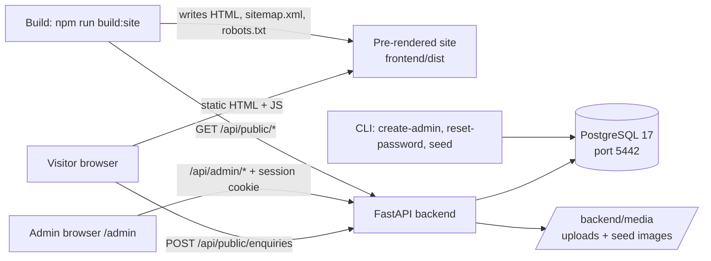

# System Design — mitali-portfolio

> Project-level decisions that rarely change. The YAML header above is machine-read by every
> builder, reviewer and tester agent. Per-feature detail belongs in `tech-spec.md`.
> Status tags: `ID [STATUS YYYY-MM-DD HH:MM]`.
> Stack chosen per layer by the developer at gate G1 (`.dev-pipeline/intake.md` section 5).

## 1. Architecture overview
A small **modular monolith**, run locally:

- **Backend** (`backend/`): one FastAPI application. It exposes a read-only public content API (used at build time by the
  pre-renderer), the public contact endpoint (used at runtime), the authenticated admin API (CRUD, uploads, enquiries,
  settings), and serves uploaded and seeded media from `backend/media/`. CLI commands live alongside it
  (`create-admin`, `reset-password`, `seed`). PostgreSQL 17 holds all content, enquiries, the admin user, sessions and
  rate-limit counters.
- **Frontend** (`frontend/`): one React + Vite + TypeScript app with two parts:
  - **Public site**: routes `/`, `/work`, `/work/:slug`, `/writing`, `/writing/:slug`, `/about`, `/contact`, `/faqs`, 404.
    At build time a pre-render script fetches all published content from the public API and renders every public route to
    static HTML (with head tags and embedded data for hydration). In the browser the pages hydrate for interactivity
    (menu, accordions, carousel, writing filter, contact form).
  - **Admin**: routes under `/admin`, rendered client-side only (one HTML shell, `noindex`), talking to the admin API with
    the session cookie.
- **Publishing**: content edits are stored immediately; the public site changes when the "rebuild site" command
  (`npm run build:site`) re-runs the pre-render (REQ-052). The backend records a `content_changed_at` timestamp; the build
  writes a `build-info.json` with its build time, which the admin dashboard compares to show "Site needs rebuilding".
- **Serving locally (single origin)**: in development the Vite dev server (port 5173) proxies `/api` and `/media` to
  FastAPI (port 8000). For a production-like local run FastAPI serves the pre-rendered `frontend/dist` as static files
  plus `/api` and `/media`, so the session cookie is first-party and no CORS is needed.

## 2. Technology decisions
| ID | Layer | Technology | Why chosen | Alternatives rejected | Status |
|----|-------|------------|-----------|----------------------|--------|
| SD-001 | Backend | Python 3.12 + FastAPI, Pydantic v2, SQLAlchemy 2.0 (async, `asyncpg`), Alembic, `pydantic-settings`; profile `stack-python-fastapi` | Developer's choice; small API surface (content CRUD, uploads, contact form, auth) fits FastAPI well; Python 3.12.6 installed | .NET (developer preference for Python) | NEW 2026-10-29 16:06 |
| SD-002 | Frontend | React 19 + Vite + TypeScript (strict), React Router (data routers), TanStack Query (admin), React Hook Form + Zod; profile `stack-react` | Developer's choice; one app covers the public site and the admin | Next.js (best SEO, but a different framework); plain React SPA (weak SEO and link previews) | NEW 2026-10-29 16:06 |
| SD-003 | Frontend / SEO | **Build-time pre-rendering with a project script** (`frontend/scripts/prerender.ts`) using Vite's SSR build of an `entry-server.tsx`, React Router's static data router (`createStaticHandler` / `createStaticRouter`) and `react-dom/server`. Route loaders fetch from the public API; each route's HTML is written to `dist/<route>/index.html` with head tags (title, description, canonical, Open Graph) and serialized loader data; the client hydrates with `createBrowserRouter` + `hydrationData`. The script also writes `sitemap.xml`, `robots.txt` and `404.html`. `/admin` gets one client-only shell. | Keeps the chosen stack (Vite + React Router, as the profile describes), gives full HTML for SEO and link previews, no runtime Node server, few dependencies | `vite-react-ssg` / `vite-plugin-ssr` (third-party, extra conventions and maintenance risk); React Router framework mode with `prerender` (changes the project structure away from the profile); Next.js (rejected at G1); runtime SSR (needs a Node server, unnecessary for a low-traffic portfolio) | NEW 2026-10-29 16:06 |
| SD-004 | Database | PostgreSQL 17, local Windows service on **port 5442** (not 5432, which is PostgreSQL 16); databases `mitali_portfolio` (dev) and `mitali_portfolio_test` (tests); profile `stack-postgresql` | Relational content with ordering, foreign keys and simple filtering; already installed; `jsonb` for small lists (channels, tags, features) | MySQL, MongoDB (discussed at G1) | NEW 2026-10-29 16:06 |
| SD-005 | Database setup | `backend/scripts/setup_db.ps1` (and `.sql`), run **by the user** with the PostgreSQL superuser via `C:\Program Files\PostgreSQL\17\bin\psql.exe -p 5442`; it creates the app role (password supplied by the user at the prompt) and both databases. App credentials live in git-ignored `backend/.env`; `backend/.env.example` is committed. Agents call psql by full path. | The superuser password is the user's only; never asked for in chat (REQ-072) | Agents creating the DB themselves (needs the superuser password) | NEW 2026-10-29 16:06 |
| SD-006 | Testing (backend) | `pytest` + `pytest-asyncio` + `httpx.AsyncClient` against the local `mitali_portfolio_test` database (schema migrated per test session, transactions rolled back per test). **Deviation from the profile:** no Testcontainers, because the Docker engine is not running and the user decided Docker is not needed. | Real PostgreSQL behaviour without Docker | Testcontainers (needs Docker), SQLite (different engine behaviour) | NEW 2026-10-29 16:06 |
| SD-007 | Auth | Single admin. Email + password hashed with **Argon2id** (`argon2-cffi`). Server-side sessions in a `sessions` table; a random 256-bit token (stored hashed) in an `HttpOnly`, `SameSite=Strict`, `Path=/` cookie (`Secure` when served over HTTPS; locally over http the flag is configurable); 8 h idle / 7 d absolute expiry. CSRF: `SameSite=Strict` plus a double-submit token (`X-CSRF-Token` header) on all state-changing admin requests. Login throttling persisted in the database (REQ-061). Admin created and reset only via CLI (REQ-062). **Deviation from the profile's OAuth2/JWT default**, recorded here. | One user, minimal attack surface, revocable sessions, nothing in `localStorage` | JWT in local storage (rejected at G1); external identity provider (overkill for one user, costs) | NEW 2026-10-29 16:06 |
| SD-008 | Media | Uploads stored on disk under `backend/media/uploads/` (seed images under `backend/media/seed/`), served by FastAPI at `/media/...`; the DB stores relative paths. Raster uploads (JPEG, PNG, WebP) are re-encoded with **Pillow** into responsive WebP sizes (e.g. 480, 960, 1600 px) and metadata is stripped; SVG uploads are sanitized and served with a restrictive CSP. Max 10 MB per file. | Local-only, no cloud storage needed; responsive images for performance (REQ-NFR-004) | Cloud blob storage (cloud deferred); serving originals only (slow pages) | NEW 2026-10-29 16:06 |
| SD-009 | Rich text | Writing-sample bodies and long texts stored as **Markdown**; the backend renders Markdown to HTML (`markdown-it-py`) and sanitizes it with an allow-list (`nh3`) when content is saved, returning `body_html`. The frontend inserts only this sanitized HTML. The admin editor is a Markdown textarea with live preview. | Safe formatting without a heavy WYSIWYG editor; one sanitization point | WYSIWYG HTML editor (larger XSS surface), plain text only (requirement asks for formatting) | NEW 2026-10-29 16:06 |
| SD-010 | Rate limiting / spam | Contact form: honeypot field + DB-backed fixed-window counter keyed by client IP (5 per 10 min). Login: DB-backed failure counter per account and per IP (5 per 15 min, 15 min block). | Survives restarts; no extra service (Redis) for a single-instance local app | `slowapi` in-memory (lost on restart), Redis (extra service), CAPTCHA (third-party, hurts UX) | NEW 2026-10-29 16:06 |
| SD-011 | Tooling | Backend dependencies with **uv** (`pyproject.toml` + `uv.lock`); lint/format `ruff`, types `mypy --strict`, security `pip-audit`, `bandit`. Frontend with npm (`package-lock.json`), ESLint, `tsc --noEmit`, Vitest + React Testing Library + MSW, Playwright for E2E, Lighthouse CI (local) for REQ-NFR-004. API client generated from `docs/api-contract.yaml` with `openapi-typescript` + `openapi-fetch`. Fonts self-hosted from the official Antonio and Public Sans releases. uv is installed under the Python user Scripts folder (not on PATH): agents run it as `python -m uv`. | Matches the profiles; reproducible installs | Poetry (uv is faster and simpler); hand-written API client (profile forbids) | NEW 2026-10-29 16:06 |
| SD-012 | Cloud / IaC / CI | None for now: local development only. `cloud: none`, `iac: none`, `ci: none`. Repository: `https://github.com/nimesh-patel-1994/mitali-portfolio` (remote `origin`; push only when the user asks). | Hosting deferred by the user | Azure + Terraform (later, via `/feature`) | NEW 2026-10-29 16:06 |
| SD-013 | Content model | Ordering via an integer `position` per entity; publish via a `is_published` flag; slugs unique per entity; sample-data flag `is_sample` on case studies, results and writing samples; singletons for profile and site settings. Detail in `tech-spec.md`. | Matches REQ-063/064/067 directly | Draft/revision history (not required) | NEW 2026-10-29 16:06 |

## 3. Non-functional targets
- **Scale:** one admin; low public traffic (hundreds of visits per day at most once hosted). Single backend instance.
- **Performance:** public pages are static HTML; Lighthouse (mobile) ≥ 90 in all four categories on a local production
  build (REQ-NFR-004); LCP image served as responsive WebP; fonts preloaded, `font-display: swap`; JS for public pages
  kept small (admin code split into its own lazy chunk, never loaded by public pages).
- **API latency (local):** p95 < 200 ms for admin reads and writes, excluding image processing (< 3 s for a 10 MB upload).
- **Availability / RPO / RTO:** not applicable while local-only. Data protection relies on the user's machine; a
  `pg_dump` backup command is documented in the README.
- **Accessibility:** WCAG 2.1 AA (REQ-NFR-002), reduced motion (REQ-NFR-003).
- **Compliance / privacy:** no regulated data. Enquiries contain names and emails; they are never logged, only shown to
  the admin, and can be archived or deleted (REQ-NFR-005).
- **Cost ceiling:** zero running cost; open-source tools and open-licence fonts only (REQ-NFR-008).
- **Responsive:** 360 px to 1920 px (REQ-NFR-001).

## 4. Environments and deployment
| Environment | Where | Database | How it runs |
|-------------|-------|----------|-------------|
| dev | User's Windows machine | `mitali_portfolio` on PostgreSQL 17, port 5442 | `uv run fastapi dev` (port 8000) + `npm run dev` (Vite, port 5173, proxy `/api` and `/media` to 8000) |
| test | Same machine, run by agents and the user | `mitali_portfolio_test`, port 5442 | `uv run pytest`; `npm test`; Playwright E2E against a locally started backend (seeded test DB) and the built site |
| local preview (production-like) | Same machine | `mitali_portfolio` | `npm run build:site` (pre-render against the running API) then FastAPI serves `frontend/dist` + `/api` + `/media` on one port |
| prod | Not defined | — | Deferred; hosting will be added through `/feature` |

Branching: `main` is the default branch on the remote; work happens on feature branches merged into `main`. The local
repository is currently on `master` with no commits; branch alignment happens at the first commit the user asks for.
Commits and pushes only on request, to `origin` only, never force-push (CLAUDE.md rule 12).

## 5. Integrations and external systems
| System | Purpose | Protocol | Auth |
|--------|---------|----------|------|
| Booking service (unspecified) | "Book a call" link | Plain outbound link (new tab) to the URL in site settings; no API | None |
| Social networks (LinkedIn, Instagram placeholders) | Footer links | Outbound links | None |
| Email (deferred) | Enquiry notifications | Not built; `notification_email` setting stored only | — |

No analytics, no third-party scripts, no external fonts or CDNs at runtime.

## 6. Cross-cutting concerns
- **Logging:** structured JSON logs from FastAPI (request id, route, status, duration); never log passwords, session
  tokens, CSRF tokens or enquiry contents (names, emails, messages).
- **Error handling:** one error envelope for the API (`{ "error": { "code", "message", "fields"? } }`) via registered
  exception handlers; the frontend maps it to field errors and toasts. Public pages have a route error boundary and a
  404 page.
- **Config and secrets:** `pydantic-settings` reading `backend/.env` (git-ignored); `backend/.env.example` committed.
  Frontend build config via `frontend/.env` (`VITE_*` holds only public values such as the site URL; the pre-render reads
  `API_BASE_URL` from the build environment). No secrets in the repository.
- **Security headers:** CSP (self only; no inline scripts except the hashed hydration-data script), `X-Content-Type-Options`,
  `Referrer-Policy`, `frame-ancestors 'none'`; detail in `security.md`.
- **Multi-tenancy / i18n:** none. English (`en`) only; dates formatted with `Intl`.
- **Content rule:** all text, images and data are original or dummy; nothing from the reference site, no hot-linking
  (CLAUDE.md rule 11).
- **Design tokens:** every UI value comes from `docs/design-brief.md` tokens (CLAUDE.md rule 10).

## 7. Decision log
| Date | Decision | Reason | Supersedes |
|------|----------|--------|-----------|
| 2026-10-29 | Stack per layer: FastAPI, one React (Vite) app with pre-rendered public pages and client-rendered `/admin`, PostgreSQL 17 on port 5442, no mobile, no cloud | Developer's choices at gate G1 | — |
| 2026-10-29 | Pre-render with a project script on Vite SSR + React Router static handler (SD-003) | Resolves the intake's open question on the pre-render approach while keeping the profile's structure | — |
| 2026-10-29 | Local test database instead of Testcontainers (SD-006) | Docker engine not running; user decided Docker is not needed | Profile default |
| 2026-10-29 | Server-side session cookie instead of OAuth2/JWT (SD-007) | Single admin, minimal surface, revocable | Profile default |
| 2026-10-29 | Case-study URLs at `/work/<slug>` | Matches the "Work" navigation label | Reference's `/projects/<slug>` |
| 2026-10-29 | Remote `origin` = github.com/nimesh-patel-1994/mitali-portfolio | Given by the user | — |
