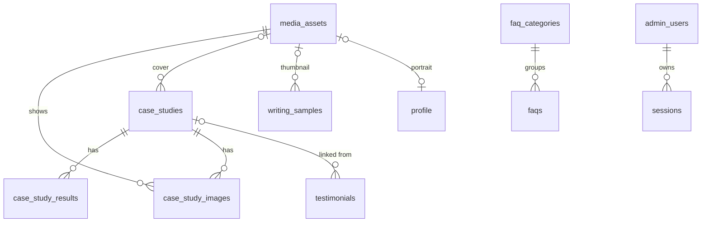
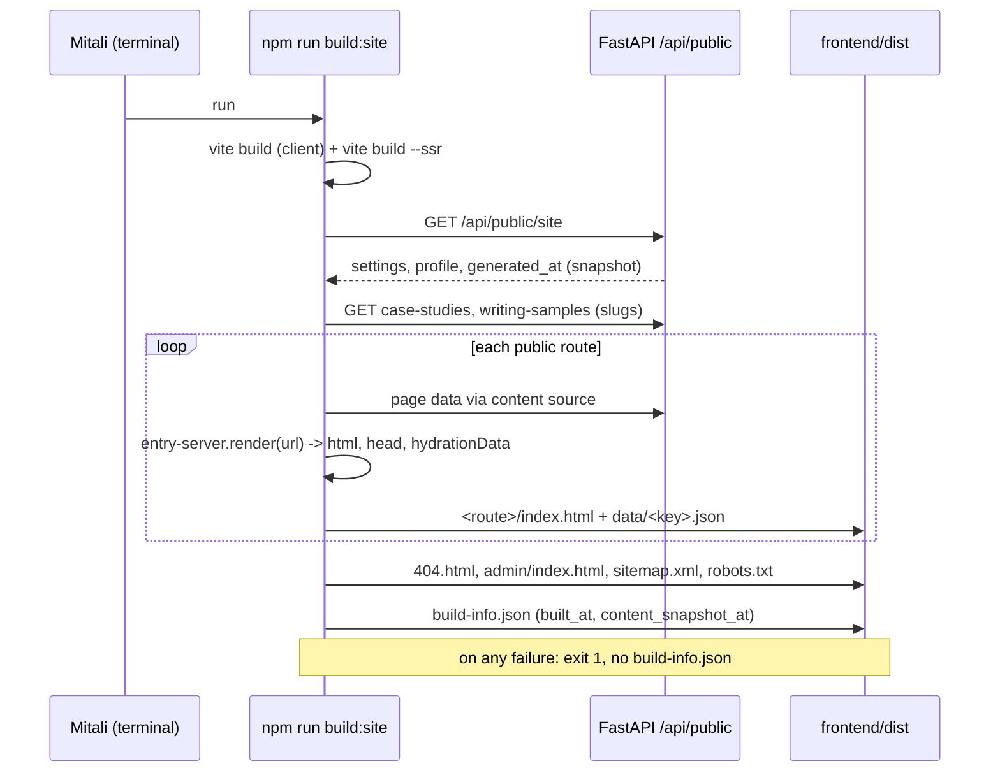
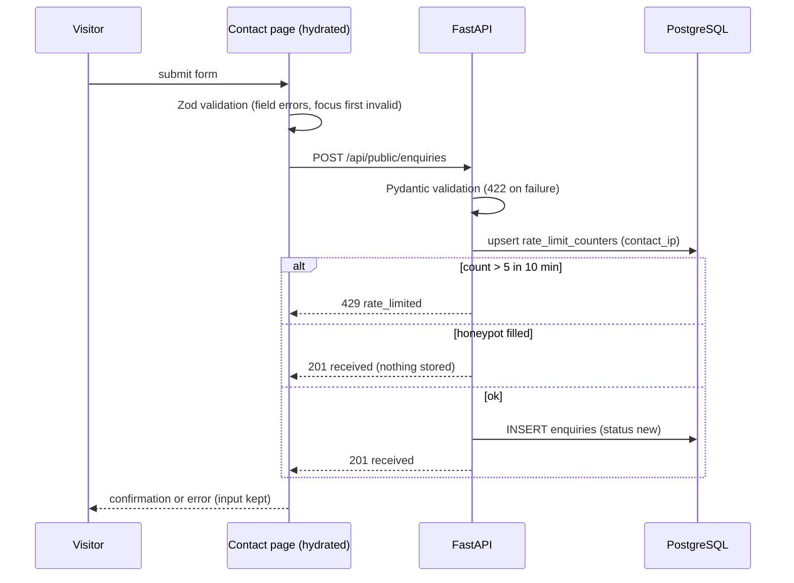
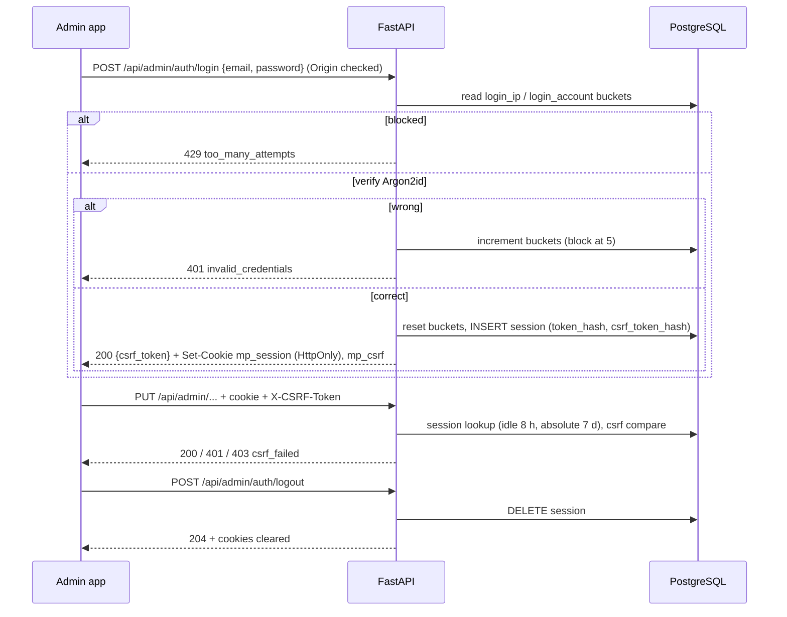
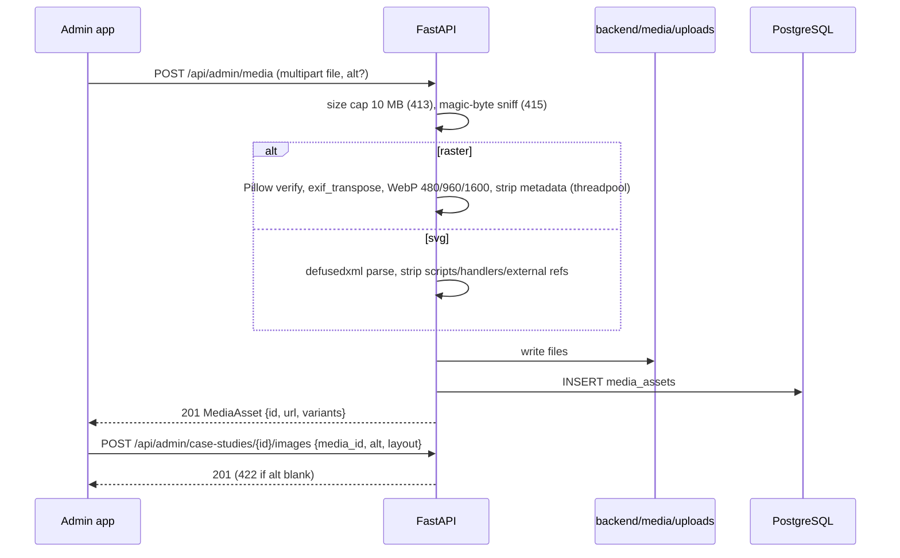

# Technical Specification — mitali-portfolio

> Per-feature technical design. Stack rationale lives in `SystemDesign.md` (SD-001..SD-013); this document links to it
> and does not repeat it. Owned by the `tech-spec` skill. Every item traces to one or more `REQ-*` IDs.
> Status tags: `ID [STATUS YYYY-MM-DD HH:MM]` (see `status-tracker`). API operations carry `x-status` in
> `api-contract.yaml`.
> Stack (from the SystemDesign header): backend `python-fastapi`, frontend `react` (two apps since CHG-012: `frontend/`, and the
> design variant `frontend-2/`, TS-020..TS-033),
> database `postgresql` (17, port 5442), auth `session-cookie`, mobile `none`, cloud `none`, ci `none`.
> Profiles: `stack-python-fastapi`, `stack-react`, `stack-postgresql`. Recorded deviations: SD-006 (local test DB, no
> Testcontainers), SD-007 (session cookie, not OAuth2/JWT).

## 1. Feature design

### TS-001 [NEW 2026-10-29 16:06] Repository layout, tooling and local run
- Implements: REQ-072, REQ-NFR-006, REQ-NFR-007, REQ-NFR-008
- Components touched: backend, frontend, repository root
- Layout (backend follows the `stack-python-fastapi` profile under `backend/app/`; frontend follows `stack-react`):
  ```
  backend/
    pyproject.toml, uv.lock                # uv (SD-011)
    .env.example                           # committed; .env is git-ignored
    alembic.ini
    migrations/                            # Alembic env.py + versions/ (0001_initial_schema.py)
    app/
      main.py                              # create_app(): routers, exception handlers, middleware, static mounts
      cli.py                               # python -m app.cli create-admin | reset-password | seed
      api/deps.py                          # get_db, get_current_admin, require_csrf, client_ip
      api/routers/public/                  # site, case_studies, writing_samples, services, engagement_models,
                                           # testimonials, faqs, values, process_steps, enquiries, health
      api/routers/admin/                   # auth, dashboard, case_studies, writing_samples, services,
                                           # engagement_models, testimonials, faq_categories, faqs, values,
                                           # process_steps, media, markdown, profile, settings, enquiries
      core/                                # config.py (pydantic-settings), security.py (argon2, tokens),
                                           # logging.py (JSON), errors.py (AppError + handlers), headers.py
      schemas/                             # Pydantic v2 request/response models (mirror api-contract.yaml)
      models/                              # SQLAlchemy 2.0 declarative models (one module per table group)
      services/                            # content, ordering, publishing, auth, rate_limit, media, markdown,
                                           # enquiries, dashboard, build_info
      repositories/                        # data access per aggregate
      seed/                                # data.py, images.py (stdlib SVG), runner.py
    media/
      seed/                                # generated placeholder SVGs (git-ignored; re-created by seed)
      uploads/                             # admin uploads (git-ignored)
    scripts/
      setup_db.ps1, setup_db.sql           # run by the user (TS-018)
      check_contract.py                    # diff generated openapi.json vs docs/api-contract.yaml (TS-019)
    tests/{unit,integration}/
  frontend/
    package.json, package-lock.json, vite.config.ts, tsconfig.json, index.html (template with placeholders)
    .env.example                           # VITE_SITE_URL only; build env API_BASE_URL documented
    scripts/prerender.ts                   # TS-005
    public/fonts/                          # self-hosted Antonio + Public Sans WOFF2 (official releases, OFL)
    src/
      entry-client.tsx                     # hydrate (public, pre-rendered) or createRoot (admin / dev)
      entry-server.tsx                     # render(url) for the pre-renderer
      app/                                 # routes.tsx, providers, RootLayout, content source (TS-005)
      api/                                 # generated: schema.d.ts (openapi-typescript), client.ts (openapi-fetch)
      features/public/{layout,home,work,case-study,writing,writing-sample,about,faqs,contact,not-found,seo}/
      features/admin/{auth,layout,dashboard,case-studies,writing-samples,services,engagement-models,
                      testimonials,faqs,values,process-steps,profile,settings,enquiries,media}/
      shared/{ui,hooks,utils}/
      styles/tokens.css, global.css        # tokens exactly as docs/design-brief.md section 6
    e2e/                                   # Playwright
  assets/brand/                            # logo files when supplied (never edited)
  README.md                                # setup, run, rebuild, backup (pg_dump) steps
  ```
- Technical flow (developer commands, all documented in the README):
  1. One-time: user runs `backend/scripts/setup_db.ps1` (TS-018); `cd backend; uv sync; uv run alembic upgrade head`;
     `uv run python -m app.cli create-admin --email <email>`; `uv run python -m app.cli seed`.
  2. Dev: `uv run fastapi dev app/main.py` (port 8000) and `cd frontend; npm run dev` (Vite 5173, proxies `/api` and
     `/media` to `http://127.0.0.1:8000`).
  3. Publish locally: `npm run build:site` (TS-005) with the backend running.
  4. Production-like preview: the backend runs with `SERVE_FRONTEND=true` (`uv run fastapi run app/main.py`), which also
     serves `frontend/dist` (TS-003).
- Config (`backend/.env`, read only via `core/config.py`): `APP_ENV` (development|test|production), `DATABASE_URL`
  (`postgresql+asyncpg://mitali_app:<pw>@localhost:5442/mitali_portfolio`), `TEST_DATABASE_URL` (…`/mitali_portfolio_test`),
  `MEDIA_ROOT` (default `media`), `FRONTEND_DIST_DIR` (default `../frontend/dist`), `SERVE_FRONTEND` (bool),
  `ALLOWED_ORIGINS` (default `http://localhost:5173,http://localhost:8000,http://127.0.0.1:8000`),
  `SESSION_COOKIE_SECURE` (default false locally), `HASH_KEY_SECRET` (random 32+ bytes; keys rate-limit buckets),
  `LOG_LEVEL`. Frontend: `VITE_SITE_URL` (canonical origin used in canonical/OG/sitemap), build-only `API_BASE_URL`
  (default `http://127.0.0.1:8000`).
- Dependencies beyond SD-001/SD-011: `argon2-cffi` (SD-007), `Pillow` + `defusedxml` (SD-008), `markdown-it-py` +
  `nh3` (SD-009), `python-multipart` (uploads). CLI uses stdlib `argparse` + `getpass` (no extra dependency).
  Frontend: `react-router` (data routers), `@tanstack/react-query`, `react-hook-form`, `zod`, `openapi-fetch`;
  dev: `openapi-typescript`, `tsx`, `vitest`, `@testing-library/react`, `msw`, `@playwright/test`, `@axe-core/playwright`,
  `@axe-core/playwright` (Lighthouse 13 is run as an external binary by the E2E harness, not as a dependency; `@lhci/cli` dropped in CHG-008). All open source, no paid services (REQ-NFR-008).
- `.gitignore` covers `backend/.env`, `frontend/.env`, `backend/media/uploads/`, `backend/media/seed/`, `frontend/dist/`,
  `frontend/dist-ssr/`, `.dev-pipeline/reference/screenshots/`.
- Error handling and edge cases: startup fails fast with a clear message when `DATABASE_URL` is missing or the DB on
  port 5442 is unreachable; `/api/health` reports DB status.
- Open risks: Node 26 is newer than some tooling targets; pin engines in `package.json` and verify Vite/Vitest support at
  build start.

### TS-002 [NEW 2026-10-29 16:06] (definition updated 2026-10-30 05:08, CHG-005) Data model and migrations
- Implements: REQ-002, REQ-004, REQ-006, REQ-011, REQ-012, REQ-013, REQ-014, REQ-015, REQ-020, REQ-021, REQ-023, REQ-030,
  REQ-031, REQ-040, REQ-041, REQ-042, REQ-043, REQ-052, REQ-060, REQ-061, REQ-063, REQ-064, REQ-065, REQ-066, REQ-067,
  REQ-NFR-005
- Components touched: backend (`models/`, `migrations/`)
- Technical flow: the full schema is in section 3. Alembic revision `0001_initial_schema` creates every table,
  constraint and index; it is reviewed as SQL (`alembic upgrade head --sql`). Revision `0001` is already applied to the
  dev and test databases and is never edited; later schema changes are new revisions:
  - `0002_settings_copy_fields` (down-revision `0001`, CHG-005, REQ-042, REQ-065): adds to `site_settings`
    `contact_promise text NOT NULL` and `footer_rights_line text NOT NULL`, each with a server default equal to the
    initial copy (section 3.2) and `CHECK (length(btrim(col)) BETWEEN 1 AND 200)` (named per the naming convention).
    `ADD COLUMN … NOT NULL DEFAULT '<text>'` fills the existing singleton row in the same statement, so no separate data
    step is needed. The single quote in the contact-promise text is escaped (`''`) in the SQL default; check the offline
    SQL. The server defaults stay in place (the SQLAlchemy model declares the same `server_default`, so `alembic check`
    shows no drift). Downgrade drops both CHECKs and columns. Verified online: upgrade, `alembic check`, downgrade to
    `0001`, upgrade again.
  Conventions (per SD-013 and the `stack-postgresql` profile):
  1. Keys: `uuid` primary keys with `DEFAULT gen_random_uuid()` (built in since PostgreSQL 13; no extension); singletons
     use `smallint id = 1` with a `CHECK (id = 1)`.
  2. Enumerations are `text` + `CHECK (col IN (...))` (easier to extend in Alembic than native enum types).
  3. Ordering: `position integer NOT NULL` scoped per parent (global for top-level types, per case study for results and
     images, per category for FAQs). No unique constraint on position (reorders rewrite the whole scope in one
     transaction, TS-010); reads order by `(position, created_at)`.
  4. Publishing: `is_published boolean NOT NULL DEFAULT false` on every public content type except results and images,
     which follow their case study.
  5. Sample flag: `is_sample boolean NOT NULL DEFAULT false` on `case_studies`, `case_study_results`, `writing_samples`.
  6. Lists of short strings (`channels`, `goals`, `tags`, `deliverables`, `features`, `skills`, `tools`, `bio`) are `jsonb`
     arrays with `CHECK (jsonb_typeof(col) = 'array')`; they are never queried inside, so no GIN indexes.
  7. `seed_key text UNIQUE NULL` on every seedable table for idempotent seeding (TS-017).
  8. `created_at` / `updated_at timestamptz NOT NULL DEFAULT now()`; `updated_at` set by the service layer on update.
  9. The table for the "values" entity is `core_values`, because `VALUES` is a reserved SQL word; the API path stays
     `/values`.
- Error handling: unique-violation on `slug` maps to 409 `slug_taken`; FK `RESTRICT` violations map to 409
  (`category_not_empty`, `media_in_use`); `CHECK` violations should never reach the DB because Pydantic validates first,
  but are mapped to 422 if they do.
- Open risks: none significant; schema is small.

### TS-003 [NEW 2026-10-29 16:06] Backend foundation: app factory, errors, pagination, logging, limits, static serving
- Implements: REQ-001, REQ-042, REQ-066, REQ-NFR-005
- Components touched: backend (`main.py`, `core/`, `api/deps.py`)
- Technical flow:
  1. `create_app()` registers routers under `/api/public` and `/api/admin`, `/api/health`, exception handlers,
     middleware (request id, JSON access log, body size limit, Origin check, security headers) and static mounts.
  2. **Error envelope** for every non-2xx response: `{ "error": { "code": str, "message": str, "fields"?: {path: message} } }`.
     Handlers: `AppError` (service-raised, carries status + code), `RequestValidationError` → 422 `validation_error` with
     `fields` keyed by dotted path without the `body.` prefix (e.g. `email`, `results.0.value`), `HTTPException`, and a
     catch-all → 500 `internal_error` (message generic, details only in logs). Codes used: `validation_error`,
     `not_found`, `unauthenticated`, `invalid_credentials`, `csrf_failed`, `origin_rejected`, `slug_taken`,
     `category_not_empty`, `media_in_use`, `order_mismatch`, `rate_limited`, `too_many_attempts`, `file_too_large`,
     `unsupported_media_type`, `invalid_image`, `payload_too_large`, `service_unavailable` (health, DB down),
     `internal_error`.
  3. **Pagination** (enquiries and media lists): query `page` (≥1, default 1) and `page_size` (1..100, default 20);
     response `{ items, total, page, page_size }`. Other admin lists are small and return plain arrays in display order.
  4. **Request limits**: JSON bodies ≤ 1 MB (`payload_too_large` 413); `POST /api/admin/media` ≤ 10 MB file + 64 KB
     form overhead (TS-011).
  5. **Origin check**: every non-GET request under `/api/admin/` (including login) must carry an `Origin` (or, failing
     that, `Referer`) whose origin is in `ALLOWED_ORIGINS`; otherwise 403 `origin_rejected`. No CORS middleware (single
     origin, SD architecture).
  6. **Logging**: JSON lines with request id, method, route template, status, duration. Never logged: request bodies,
     cookies, `X-CSRF-Token`, passwords, enquiry fields (REQ-NFR-005).
  7. **Static serving**: `/media/*` from `MEDIA_ROOT` with `X-Content-Type-Options: nosniff`; files under `uploads/` get
     `Cache-Control: public, max-age=31536000, immutable` (UUID names), `seed/` gets `max-age=3600`; `.svg` responses add
     `Content-Security-Policy: default-src 'none'; style-src 'unsafe-inline'; sandbox` (SD-008). Path traversal is
     prevented by Starlette `StaticFiles` and by storing only relative, validated paths.
  8. **Frontend serving** (`SERVE_FRONTEND=true`, production-like preview only): a catch-all GET handler registered after
     the API routes resolves `/<path>` to the file `dist/<path>` (assets, `sitemap.xml`, `robots.txt`, `data/*.json`) or
     to `dist/<path>/index.html`; `/admin` and `/admin/*` return `dist/admin/index.html`; anything else returns
     `dist/404.html` with **status 404** (REQ-001). Trailing slashes redirect (308) to the
     slash-less canonical path. `build-info.json` is not served publicly (read from disk by the backend, TS-015).
     HTML responses: `Cache-Control: no-cache`; `/assets/*` and `/fonts/*.woff2|.woff`: immutable (fonts are fixed
     files; a changed font needs a new file name). Compression (CHG-008/010, 2026-10-31 00:12): text types (html, js, mjs, css,
     json, svg, xml, txt) are sent as the precompressed `.br`/`.gz` written by the pre-render (`scripts/compress.ts`) when
     the client accepts it, else gzipped on the fly (≥ 256 B); `Vary: Accept-Encoding`; never for `/api/*` (BREACH:
     admin JSON carries the CSRF token) or `/media`; direct requests for `.br`/`.gz` files return the 404 page.
  9. **Security headers** on HTML and API responses: CSP `default-src 'self'; script-src 'self'; style-src 'self';
     img-src 'self' data:; font-src 'self'; connect-src 'self'; object-src 'none'; base-uri 'self'; form-action 'self';
     frame-ancestors 'none'`, `X-Content-Type-Options: nosniff`, `Referrer-Policy: strict-origin-when-cross-origin`,
     `X-Frame-Options: DENY`. Admin HTML and all `/api/admin` responses add `X-Robots-Tag: noindex, nofollow` and
     `Cache-Control: no-store`. Final list is owned by `security.md`.
- Error handling and edge cases: the Vite dev server always answers 200 for unknown routes; the 404 status of REQ-001
  is verified on the production-like preview only (open question 5).
- Open risks: CSP `style-src 'self'` forbids inline `style` attributes; components must use classes and CSS variables
  defined in stylesheets (see TS-006).

### TS-004 [NEW 2026-10-29 16:06] Public content API (read-only, published content)
- Implements: REQ-002, REQ-004, REQ-006, REQ-011, REQ-012, REQ-013, REQ-014, REQ-015, REQ-020, REQ-021, REQ-022, REQ-023,
  REQ-030, REQ-031, REQ-040, REQ-041, REQ-050
- Components touched: backend (`api/routers/public/*`, `services/content`, `repositories/*`)
- Technical flow: GET-only, unauthenticated, used by the pre-renderer at build time (and by the Vite dev server in
  development). Every query filters `is_published = true` and orders by `(position, created_at)`. Operations
  (`api-contract.yaml`, tag `public`): `getPublicSite`, `listPublicCaseStudies` (`?featured=true`),
  `getPublicCaseStudy`, `listPublicWritingSamples` (`?format=`), `getPublicWritingSample`, `listPublicServices`,
  `listPublicEngagementModels`, `listPublicTestimonials`, `listPublicFaqGroups`, `listPublicFaqPreview`,
  `listPublicValues`, `listPublicProcessSteps`, `getHealth`.
  1. `getPublicSite` returns `generated_at` (server clock; used for the rebuild comparison and the footer year), the
     public subset of settings (never `notification_email`) and the profile.
  2. Case-study detail includes results and images (ordered), `problem_html`/`solution_html` (sanitized, TS-012) and
     `more_work`: the next 2 published case studies after the current one by position, wrapping around; fewer if fewer
     exist (REQ-021).
  3. FAQ groups: published categories with ≥1 published FAQ, each with its published FAQs. FAQ preview: published FAQs
     with `show_in_preview = true` in a published category, ordered by category position then FAQ position (REQ-006).
  4. Testimonials expose `case_study_slug` only when the linked case study is published.
  5. Images are returned as `ImageRef` (`url`, `alt`, `width`, `height`, `mime`, `srcset[]`) with root-relative
     `/media/...` URLs; alt comes from the usage (cover_alt, image alt, thumbnail_alt, portrait_alt).
  6. Sample flags (`is_sample` on case study, results, writing sample) are passed through for the "Sample data" labels
     (REQ-023).
- Error handling: unknown or unpublished slug → 404 `not_found` (REQ-022). Unknown `format` value → 422.
- Open risks: N+1 on lists; repositories use `selectinload` for results/images/cover media.

### TS-005 [NEW 2026-10-29 16:06] Build-time pre-render and publishing ("rebuild site")
- Implements: REQ-001, REQ-004, REQ-022, REQ-050, REQ-051, REQ-052, REQ-NFR-004
- Components touched: frontend (`scripts/prerender.ts`, `entry-server.tsx`, `entry-client.tsx`, `app/routes.tsx`,
  `app/content-source.ts`, `features/public/seo`), backend (read by TS-015)
- Technical flow (per SD-003; sequence diagram 4.1):
  1. `npm run build:site` = `vite build` (client bundle, `dist/`, with `index.html` template containing
     `<!--app-head-->`, `<!--app-html-->`, `<!--app-data-->`) → `vite build --ssr src/entry-server.tsx --outDir dist-ssr` →
     `tsx scripts/prerender.ts`.
  2. The script reads `API_BASE_URL` and `VITE_SITE_URL`, calls `getPublicSite` first and keeps its `generated_at` as the
     **content snapshot time**, then lists published case-study and writing-sample slugs. Route list: `/`, `/work`,
     `/writing`, `/about`, `/contact`, `/faqs`, `/work/<slug>` per published case study, `/writing/<slug>` per published
     writing sample.
  3. **Content source**: route loaders never call `fetch` directly; they call `contentSource.get(key)` with a data key
     (`site`, `home`, `work`, `work/<slug>`, `writing`, `writing/<slug>`, `about`, `contact`, `faqs`). Three
     implementations: *api* (build time and `npm run dev`; composes the key from public API calls through the generated
     client), *static* (browser, production build; fetches `/data/<key>.json`), chosen by environment. Page aggregates:
     `home` = featured case studies (first 4) + services + engagement models + testimonials + FAQ preview; `work` = case
     studies + FAQ preview; `about` = values + process steps + FAQ preview; `contact` = FAQ preview; `faqs` = groups;
     profile and settings come from `site` (root layout loader).
  4. For each route: `entry-server.render(url)` runs React Router's `createStaticHandler(routes).query(request)`, renders
     `<StaticRouterProvider>` with `react-dom/server` (`renderToString` after data is loaded), and returns `{ html, head,
     hydrationData, status }`. `head` comes from each route's `handle.meta(loaderData, site)` → `<title>`, meta
     description, `<link rel="canonical">` (`VITE_SITE_URL` + path, no trailing slash), `og:title`, `og:description`,
     `og:image` (absolute URL of the cover/thumbnail/portrait, else a default image), `og:type`, `og:url`,
     `twitter:card`. Static pages take title/description from `features/public/content/copy.ts`; case studies use title +
     summary, writing samples title + excerpt.
  5. The script writes `dist/<route>/index.html` (`/` → `dist/index.html`), inserting head, HTML and hydration data as
     `<script type="application/json" id="__ROUTER_DATA__">` with `<`, `>`, `&`, U+2028/2029 escaped. JSON data blocks are
     not executed, so CSP needs no inline-script hash. It also writes `dist/data/<key>.json` for client-side navigation
     (the public site never calls the content API at runtime).
  6. `404.html`: render of the `*` route (NotFound, `noindex`), status 404 (REQ-001, REQ-022). Unpublished/unknown slugs
     simply have no file, so the server answers with `404.html`.
  7. Admin shell: `dist/admin/index.html` from the same template with `<meta name="robots" content="noindex, nofollow">`,
     no pre-rendered body and no data; the admin route tree is lazy-loaded (`route.lazy`) into its own chunk that public
     pages never load.
  8. `sitemap.xml`: absolute URLs of the 6 static pages + every published detail page, `<lastmod>` from `updated_at`
     (static pages: snapshot time); nothing under `/admin` (REQ-051). `robots.txt`: `User-agent: *`, `Disallow: /admin`,
     `Sitemap: <VITE_SITE_URL>/sitemap.xml`.
  9. `build-info.json` (last step, written only when every route succeeded): `{ "built_at": <ISO now>,
     "content_snapshot_at": <generated_at from step 2>, "pages": <n>, "app_version": <package.json version> }`.
  10. Client (`entry-client.tsx`): if `__ROUTER_DATA__` exists → `createBrowserRouter(routes, { hydrationData })` +
      `hydrateRoot`; otherwise (admin shell, dev) → `createRoot`. Footer year uses the year of `site.generated_at` so
      server and client render the same value (REQ-004).
- Error handling and edge cases: the script exits non-zero and does not write `build-info.json` if the API is unreachable
  or any route render throws (other than the intentional 404 page); a failed build therefore keeps "needs rebuild"
  visible. `/writing?format=…` is served the unfiltered `/writing` HTML; the filter is applied only after hydration
  (TS-006) to avoid hydration mismatches. Vite empties `dist/` at build start, so the preview site is briefly unavailable
  during a rebuild (accepted for local use).
- Open risks: React Router static-handler API details differ between minor versions; pin `react-router` and cover the
  render function with a unit test that renders `/` and `/work/<slug>` from fixtures.

### TS-006 [NEW 2026-10-29 16:06] Public frontend: routing, layout, pages and interactions
- Implements: REQ-001, REQ-002, REQ-003, REQ-004, REQ-005, REQ-006, REQ-010, REQ-011, REQ-012, REQ-013, REQ-014,
  REQ-015, REQ-020, REQ-021, REQ-022, REQ-023, REQ-030, REQ-031, REQ-040, REQ-041, REQ-042, REQ-NFR-001, REQ-NFR-002,
  REQ-NFR-003, REQ-NFR-004, REQ-NFR-007
- Components touched: frontend (`src/app`, `src/features/public/*`, `src/shared`, `src/styles`)
- Routing (`app/routes.tsx`, one tree shared by server and client):
  | Path | Route module | Loader key | Notes |
  |------|--------------|-----------|-------|
  | (layout) | `features/public/layout` | `site` | Header, footer, skip link, `<main>` |
  | `/` | `home` | `home` | Hero `h1`, featured work (≤4), services accordion, engagement cards, story block, testimonial carousel, FAQ preview |
  | `/work` | `work` | `work` | Case-study card grid, FAQ preview |
  | `/work/:slug` | `case-study` | `work/<slug>` | Cover, details block, problem, solution, results row, gallery, more work |
  | `/writing` | `writing` | `writing` | Card grid + format filter from `?format=` (`shouldRevalidate` false on search change) |
  | `/writing/:slug` | `writing-sample` | `writing/<slug>` | Meta, tags, sanitized `body_html` |
  | `/about` | `about` | `about` | Statement hero, origin, vision, values, staircase steps, story, FAQ preview, CTA band |
  | `/contact` | `contact` | `contact` | Form (TS-007), contact email, FAQ preview |
  | `/faqs` | `faqs` | `faqs` | Grouped accordions, CTA band |
  | `*` | `not-found` | — | 404 page, link home, `noindex` |
  | `/admin/*` | `features/admin` (lazy) | — | TS-016 |
  Each route has an `errorElement`; a loader 404 (`throw new Response(null, {status: 404})`) renders the not-found page.
- Technical notes:
  1. Header (REQ-002/003): nav links via `NavLink` (sets `aria-current="page"`); "Book a call" uses `settings.booking_url`
     with `target="_blank" rel="noopener noreferrer"` when it is a valid `http(s)` URL, otherwise links to `/contact`.
     Compact state toggled by an `IntersectionObserver` sentinel (no scroll listeners). Mobile menu below 810 px: dialog
     pattern with focus trap, Escape/close returns focus to the menu button, closes on route change.
  2. Wordmark component (REQ-005): renders text "MITALI" with an accessible name; swapping to a logo from `assets/brand/`
     only changes this component.
  3. Accordions (services, FAQs): `<button aria-expanded aria-controls>` + region; content present in the pre-rendered
     HTML (collapsed with the `hidden` attribute until hydrated, so it is indexable and works keyboard-only).
  4. Carousel (REQ-015): no autoplay; prev/next buttons and indicator buttons; wraps around; live region
     `aria-live="polite"` announces the active quote; swipe via pointer events.
  5. Writing filter (REQ-030): filter chips are links `?format=<value>` (works without JS: the static `/writing` lists all
     samples); after hydration a `useHydrated()` gate applies the URL filter client-side; empty state with "Show all".
  6. Body HTML (REQ-031): rendered only through `shared/ui/SanitizedHtml`, which is the single reviewed use of
     `dangerouslySetInnerHTML` and only accepts `body_html` / `problem_html` / `solution_html` from the API.
  7. Sample labels (REQ-023): results row shows a "Sample data" note when any of its results has `is_sample`; the
     details block shows "Sample case study" when the case study has `is_sample`; writing cards and detail show "Sample"
     when the sample has `is_sample`.
  8. Images: `shared/ui/ResponsiveImage` renders `srcset`/`sizes` from `ImageRef`, `width`/`height` to avoid layout
     shift, `loading="lazy"` except the LCP image (`fetchpriority="high"`) (REQ-NFR-004).
  9. Styling: CSS Modules reading only tokens from `styles/tokens.css` (design brief section 6); section components set
     the surface aliases. No inline `style` attributes (CSP, TS-003). Fonts preloaded from `public/fonts`,
     `font-display: swap`. Motion only inside `@media (prefers-reduced-motion: no-preference)` (REQ-NFR-003).
  10. Static copy (hero statements, section headings, CTA bands, privacy note, page meta) lives in
      `features/public/content/copy.ts` (original wording; open question 4).
- Error handling: route error boundary shows a friendly message; images with missing media fall back to a token-coloured
  block.
- Open risks: hydration mismatches (dates, year, filter) — all derived from loader data, never `Date.now()` at render.

### TS-007 [NEW 2026-10-29 16:06] Contact enquiry submission
- Implements: REQ-042, REQ-043, REQ-NFR-005
- Components touched: backend (`routers/public/enquiries`, `services/enquiries`, `services/rate_limit`), frontend
  (`features/public/contact`)
- Technical flow (sequence diagram 4.2), operation `createEnquiry` (`POST /api/public/enquiries`):
  1. Frontend: React Hook Form + Zod schema mirroring the contract (name 1..120, email ≤254 valid, enquiry_type enum,
     budget_range optional enum, company optional ≤120, message 1..5000, honeypot `website` hidden from users and
     assistive tech: off-screen, `tabindex="-1"`, `autocomplete="off"`, `aria-hidden`). On client errors: field messages,
     focus first invalid field. On success: replace form with confirmation (focus moves to it). On 429/5xx/network: show
     error banner, keep input.
  2. Backend: Pydantic validation (trimmed strings, `EmailStr`) → 422 `validation_error` with `fields`, nothing stored.
  3. Rate limit (SD-010): bucket `contact_ip`, key = HMAC-SHA256(`HASH_KEY_SECRET`, client IP), fixed window 10 min,
     limit 5 accepted submissions. Atomic `INSERT … ON CONFLICT (bucket, key_hash) DO UPDATE` that resets the window when
     expired and increments otherwise, returning the new count; count > 5 → 429 `rate_limited` with `Retry-After`.
     Only submissions that passed validation count (honeypot submissions count too).
  4. Honeypot: if `website` is non-empty → return the normal 201 response, store nothing, log only "honeypot hit"
     without content.
  5. Insert enquiry with `status = 'new'`; return 201 `{ "received": true }`. No content of the enquiry is logged.
- Data model: `enquiries`, `rate_limit_counters` (section 3).
- Error handling: DB failure → 500 envelope; the form keeps input. Client IP is `request.client.host` (no proxy headers
  trusted locally; revisit when hosted).
- Open risks: budget range values and currency (open question 2).

### TS-008 [NEW 2026-10-29 16:06] Admin authentication, session, CSRF and login throttle
- Implements: REQ-060, REQ-061, REQ-NFR-005
- Components touched: backend (`routers/admin/auth`, `services/auth`, `services/rate_limit`, `core/security`,
  `api/deps`), frontend (`features/admin/auth`)
- Technical flow (per SD-007/SD-010; sequence diagram 4.3), operations `adminLogin`, `adminLogout`, `getAdminMe`:
  1. **Login** `POST /api/admin/auth/login {email, password}` (Origin check applies; no session or CSRF token yet):
     a. Normalise email (trim, lowercase). Compute bucket keys `login_ip` (HMAC of client IP) and `login_account`
        (HMAC of email).
     b. If either bucket has `blocked_until > now()` → 429 `too_many_attempts` with `Retry-After` (even with the correct
        password).
     c. Load admin by email; verify with Argon2id (`argon2-cffi` defaults: time cost 3, memory 64 MiB, parallelism 4).
        Unknown email still verifies against a fixed dummy hash (equal timing). Verification runs in the threadpool.
     d. Failure: increment both buckets (15 min fixed window); when a count reaches 5 set `blocked_until = now() + 15 min`;
        return 401 `invalid_credentials` "Email or password is incorrect."
     e. Success: reset both buckets; if `check_needs_rehash` → rehash; delete expired sessions of this admin; create
        session: `token = secrets.token_urlsafe(32)` (256 bit), `csrf = secrets.token_urlsafe(32)`; store SHA-256 of each;
        `last_seen_at = now()`, `absolute_expires_at = now() + 7 d`. Set cookies:
        `mp_session=<token>; HttpOnly; SameSite=Strict; Path=/; Max-Age=604800; Secure` (Secure when
        `SESSION_COOKIE_SECURE`) and `mp_csrf=<csrf>; SameSite=Strict; Path=/` (readable by JS, double-submit).
        Response 200 `AdminSession { email, csrf_token, idle_expires_at, absolute_expires_at }`.
  2. **Every admin request** (`get_current_admin` dependency): read `mp_session`, look up by SHA-256 hash; reject (401
     `unauthenticated`) when missing, unknown, `last_seen_at + 8 h < now()` or `absolute_expires_at < now()` (expired rows
     are deleted). `last_seen_at` is refreshed at most once per minute.
  3. **CSRF** (`require_csrf` dependency on every POST/PUT/PATCH/DELETE under `/api/admin` except login): header
     `X-CSRF-Token` must be present, equal the `mp_csrf` cookie, and its SHA-256 must equal the session's
     `csrf_token_hash` (constant-time compare) → otherwise 403 `csrf_failed`. Together with `SameSite=Strict` and the
     Origin check this is the double-submit design of SD-007, additionally bound to the session.
  4. **Me** `GET /api/admin/auth/me` → 200 `AdminSession` (returns the CSRF token so the admin app can keep it in memory
     after a reload) or 401.
  5. **Logout** `POST /api/admin/auth/logout` (session + CSRF) → delete the session row, expire both cookies, 204.
     Requests with the old cookie then get 401 (REQ-060).
- Data model: `admin_users`, `sessions`, `rate_limit_counters`.
- Error handling: generic message for wrong email or password (REQ-060); 429 message "Too many attempts. Try again in
  15 minutes." Rate-limit rows older than 1 day are deleted opportunistically on login.
- Open risks: per-account blocking lets anyone lock the admin out for 15 minutes by guessing (open question 6).

### TS-009 [NEW 2026-10-29 16:06] Admin CLI: create-admin and reset-password
- Implements: REQ-062
- Components touched: backend (`app/cli.py`, `services/auth`)
- Technical flow (`uv run python -m app.cli <command>`, argparse; exit code 0 on success, 1 on refusal):
  1. `create-admin --email <email>`: refuses if any admin exists (also enforced by the single-row unique index on
     `admin_users`). Password read twice with `getpass` (never a CLI argument, so it is not kept in shell history);
     `--password-stdin` reads one line from stdin for automated tests. Policy: 12..128 characters, not equal to the
     email or its local part; otherwise the command prints why and exits 1. Stores the Argon2id hash.
  2. `reset-password [--email <email>]`: same prompts and policy; updates the hash and `password_changed_at`, **deletes
     all sessions** of the admin and clears the `login_account` throttle bucket for that email (REQ-062).
  3. `seed` is described in TS-017.
- Error handling: DB unreachable → clear message, exit 1. Passwords are never echoed or logged.
- Open risks: none.

### TS-010 [NEW 2026-10-29 16:06] Admin content management: CRUD, publish, reorder, sample flag
- Implements: REQ-052, REQ-063, REQ-064, REQ-067
- Components touched: backend (`routers/admin/*`, `services/content`, `services/ordering`, `services/publishing`),
  frontend (TS-016)
- Technical flow: one router per content type with the same pattern (all require session; mutations require CSRF):
  `GET list` (all items incl. unpublished, display order), `POST` create, `GET {id}`, `PUT {id}` (full replace of the
  editable fields; no mass assignment: input schemas list exactly the editable fields), `DELETE {id}` (204),
  `PUT …/order`. Types: case studies, writing samples, services, engagement models, testimonials, FAQ categories, FAQs,
  values, process steps. Case studies have nested results and images (`/case-studies/{id}/results[...]`,
  `/case-studies/{id}/images[...]`); the case-study `GET {id}` returns them embedded.
  1. **Create**: `position = max(position in scope) + 1` (0 when empty). Slugs: `^[a-z0-9]+(?:-[a-z0-9]+)*$`, ≤ 80
     chars; the admin form suggests one from the title.
  2. **Reorder** `PUT …/order { ids: [...] }` (FAQs: `{ category_id, ids }`): the id set must equal exactly the current
     set in the scope (else 422 `order_mismatch`, e.g. stale list); positions rewritten 0..n-1 in one transaction with
     `SELECT … FOR UPDATE` on the scope. Order routes are registered before `/{id}` routes.
  3. **Publish/unpublish** and **sample flag** (REQ-067) are fields of the `PUT` input (`is_published`, `is_sample`;
     results carry their own `is_sample`). The admin "Clear sample flags" action on a case study issues the case-study
     PUT and one result PUT per flagged result.
  4. **Delete**: case study → `ON DELETE CASCADE` removes results and gallery rows (REQ-063; the confirmation dialog is
     in the UI). FAQ category with FAQs → 409 `category_not_empty` "Move or delete the FAQs in this category first."
     (REQ-064). Testimonials linked to a deleted case study keep their row (`SET NULL`). Media files are not deleted with
     the content (see TS-011).
  5. **Moving an FAQ** to another category (PUT with a new `category_id`) appends it at the end of the target category.
  6. **Validation**: alt text required (non-blank) for gallery images and whenever a cover/thumbnail/portrait media id is
     set (REQ-063); referenced `media_id`s must exist (422 `fields.media_id`); markdown fields are rendered and sanitized
     on save (TS-012).
  7. **Content change marker** (REQ-052): every successful create/update/delete/reorder of content, profile or settings
     sets `site_settings.content_changed_at = now()` in the same transaction (`services/publishing.touch()`).
     Enquiry changes and media uploads do not.
- Error handling: 404 for unknown ids (also for nested items whose parent differs); 409 `slug_taken` with
  `fields.slug`; 422 envelope with field paths.
- Open risks: concurrent admin tabs can overwrite each other (single user, accepted; no optimistic locking).

### TS-011 [NEW 2026-10-29 16:06] Media upload pipeline
- Implements: REQ-063, REQ-064, REQ-065, REQ-NFR-004
- Components touched: backend (`routers/admin/media`, `services/media`), frontend (`features/admin/media` picker)
- Technical flow (per SD-008; sequence diagram 4.4), operations `uploadAdminMedia`, `listAdminMedia`,
  `deleteAdminMedia`:
  1. `POST /api/admin/media` (multipart: `file`, optional `alt`); session + CSRF. Reject early on `Content-Length` >
     10 MB + 64 KB; stream the part to a temp file under `MEDIA_ROOT/tmp/` counting bytes, abort at 10 MB → 413
     `file_too_large` "Images must be 10 MB or smaller."
  2. Detect the type from magic bytes (not the filename or client content type): JPEG `FF D8 FF`, PNG `89 50 4E 47 0D 0A
     1A 0A`, WebP `RIFF....WEBP`, SVG = UTF-8 text whose root element (parsed with `defusedxml`) is `svg`. Anything else
     → 415 `unsupported_media_type` "Upload a JPEG, PNG, WebP or SVG image."
  3. Raster (run in the threadpool): `Image.open` + `verify`, reopen, reject > 40 megapixels (`Image.MAX_IMAGE_PIXELS`),
     `ImageOps.exif_transpose`, convert to RGB/RGBA, produce WebP variants at widths 480, 960, 1600 (never upscaled; the
     original width is used when smaller), quality 80, no EXIF/ICC/XMP metadata. Files:
     `uploads/<yyyy>/<mm>/<uuid>-<width>.webp`. The original is not kept. Corrupt image → 422 `invalid_image`.
  4. SVG: parse with `defusedxml` (DTDs/entities rejected), remove `script`, `foreignObject`, `iframe`, `embed`,
     `object`, all `on*` attributes, `href`/`xlink:href` not starting with `#`, and `style` values containing `url(` or
     `@import`; re-serialise to `uploads/<yyyy>/<mm>/<uuid>.svg`. Dimensions from `width`/`height` or `viewBox`.
  5. Insert `media_assets` (relative path of the largest variant, `variants`, `mime`, `width`, `height`, `bytes`,
     `original_filename` sanitised for display, optional default `alt`, `source = 'upload'`). Return 201 `MediaAsset`.
     The client then puts the `media_id` into the case-study image, cover, thumbnail or portrait field with its alt text.
  6. `GET /api/admin/media` (paginated, newest first) lets the admin re-use an image. `DELETE /api/admin/media/{id}`
     refuses with 409 `media_in_use` while any row references it (FK `RESTRICT`), otherwise deletes the row and files.
- Error handling: temp files removed in `finally`; DB insert failure removes written files.
- Open risks: deleting content leaves unreferenced media until the admin deletes it in the media picker (accepted).

### TS-012 [NEW 2026-10-29 16:06] Markdown rendering and sanitization
- Implements: REQ-031, REQ-064
- Components touched: backend (`services/markdown`, `routers/admin/markdown`), frontend (admin Markdown editor,
  `SanitizedHtml`)
- Technical flow (per SD-009):
  1. `render_markdown(md) -> (html, word_count, reading_time_min)`: `markdown-it-py` CommonMark preset with `html=False`
     (raw HTML in Markdown is escaped), tables and strikethrough enabled, `linkify` off. Headings are shifted one level
     (`#` → `h2`) so the page keeps a single `h1`.
  2. Sanitize with `nh3`: tags `p, h2, h3, h4, ul, ol, li, strong, em, del, a, blockquote, code, pre, hr, br, table,
     thead, tbody, tr, th, td`; attributes `a[href, title]`, `th/td[align]`; URL schemes `http, https, mailto`; `rel`
     forced to `noopener noreferrer nofollow` on links. No images in bodies (avoids hot-linking; images belong in media).
  3. Applied on save for `writing_samples.body_md`, `case_studies.problem_md`, `case_studies.solution_md`; results are
     stored in `*_html`. `word_count` counts words of the rendered text; `reading_time_min = max(1, ceil(words / 200))`.
  4. Live preview: `POST /api/admin/markdown/preview { markdown }` (session + CSRF, ≤ 100 000 chars) returns the same
     sanitized HTML so preview and site match. The admin client debounces calls (400 ms).
  5. The seed uses the same function.
- Error handling: markdown over 100 000 chars → 422.
- Open risks: if the allow-list changes later, stored HTML must be re-rendered (one-off script via `/feature`).

### TS-013 [NEW 2026-10-29 16:06] (definition updated 2026-10-30 05:08, CHG-005) Profile and site settings
- Implements: REQ-002, REQ-004, REQ-014, REQ-042, REQ-065
- Components touched: backend (`routers/admin/profile`, `routers/admin/settings`), frontend (admin forms; public layout)
- Technical flow: operations `getAdminProfile`, `updateAdminProfile`, `getAdminSettings`, `updateAdminSettings`
  (singletons, created by migration with placeholder values so GET never 404s).
  1. Profile input: `name`, `headline`, `bio` (1..6 paragraphs, each ≤ 1200 chars), `skills`, `tools` (≤ 30 items, each
     ≤ 60 chars), `years_experience` (0..60 or null), `origin_statement` (≤ 600), `vision_blocks` (exactly 2 ×
     `{heading ≤ 80, body ≤ 600}`), `portrait_media_id` + `portrait_alt`.
  2. Settings input: `contact_email` (valid email), `booking_url` (empty/null, `#`, or an absolute `http(s)` URL),
     `social_links` (≤ 8 × `{label ≤ 40, url http(s)}`), `footer_signoff` (≤ 120), `contact_promise` (required, plain
     text, trimmed, 1..200 chars, not blank), `footer_rights_line` (required, plain text, trimmed, 1..200 chars, not
     blank), `notification_email` (valid email or null; stored only, no email is sent). Invalid values → 422 with field
     errors and nothing saved (REQ-065).
  3. Both updates call `publishing.touch()` (TS-010). `content_changed_at` is read-only in the API.
  4. `contact_promise` and `footer_rights_line` (CHG-005) are also public: `getPublicSite` returns them in
     `settings` (`PublicSettings`). The Contact page shows `contact_promise` under its heading (REQ-042) and the footer
     bottom bar shows `footer_rights_line` (replacing the static `copy.ts` strings). Both are rendered as plain text
     (React escaping; no Markdown, no HTML). Initial values (migration `0002` server defaults, TS-002):
     - `contact_promise`: `Tell me what you're working on. I reply to every enquiry within two working days.`
     - `footer_rights_line`: `All rights reserved. Words, as always, are my own.`
     They reach the public site after the next rebuild, like every other setting (TS-005).
- Error handling: 422 envelope; unknown media id → 422 `fields.portrait_media_id`; blank or over-long
  `contact_promise` / `footer_rights_line` → 422 `fields.contact_promise` / `fields.footer_rights_line`.
- Open risks: none.

### TS-014 [NEW 2026-10-29 16:06] Enquiry management
- Implements: REQ-066, REQ-NFR-005
- Components touched: backend (`routers/admin/enquiries`), frontend (`features/admin/enquiries`)
- Technical flow: `listAdminEnquiries` (`?status=new|replied|archived`, `page`, `page_size`; newest first by
  `created_at DESC, id`), `getAdminEnquiry`, `updateAdminEnquiryStatus` (`PATCH {status}`; any status to any status),
  `deleteAdminEnquiry` (204, hard delete; REQ-NFR-005 "kept until the admin deletes or archives them").
  Index `(status, created_at DESC)` serves the filtered list.
- Error handling: 404 unknown id; 422 invalid status.
- Open risks: enquiry contents are personal data: never logged, never returned by public endpoints.

### TS-015 [NEW 2026-10-29 16:06] Admin dashboard and "needs rebuild" notice
- Implements: REQ-052, REQ-066
- Components touched: backend (`routers/admin/dashboard`, `services/build_info`), frontend (`features/admin/dashboard`)
- Technical flow: `getAdminDashboard` returns `new_enquiries` (count of `status = 'new'`), `content_changed_at`,
  `last_build` (`built_at`, `content_snapshot_at` read from `FRONTEND_DIST_DIR/build-info.json`; null when missing or
  unreadable), `needs_rebuild` (`last_build is null` or `content_changed_at > last_build.content_snapshot_at`),
  `rebuild_command` (`"cd frontend; npm run build:site"`) and per-type counts (`total`, `published`). Comparing with the
  snapshot time taken from the server clock at build start avoids clock skew and catches edits made during a build.
  The dashboard shows the notice with the command when `needs_rebuild` is true (REQ-052).
- Error handling: malformed `build-info.json` → treated as "no build" and logged as a warning.
- Open risks: the backend must be able to read `frontend/dist` (same machine; true locally; revisit when hosted).

### TS-016 [NEW 2026-10-29 16:06] Admin frontend app
- Implements: REQ-060, REQ-063, REQ-064, REQ-065, REQ-066, REQ-067, REQ-NFR-002
- Components touched: frontend (`src/features/admin/*`, `src/api`)
- Routes (client-rendered, lazy chunk, `noindex`):
  `/admin/login`, `/admin` (dashboard), `/admin/case-studies`, `/admin/case-studies/new`, `/admin/case-studies/:id`
  (tabs: details, results, gallery), `/admin/writing`, `/admin/writing/new`, `/admin/writing/:id`, `/admin/services`,
  `/admin/engagement-models`, `/admin/testimonials`, `/admin/faqs` (categories and their FAQs), `/admin/values`,
  `/admin/process-steps`, `/admin/profile`, `/admin/settings`, `/admin/enquiries`, `/admin/enquiries/:id`.
  Small types (services, engagement models, testimonials, values, process steps, FAQs) edit in a list + side panel form
  rather than separate pages.
- Technical notes:
  1. Guard: the admin layout loader calls `getAdminMe`; 401 → redirect to `/admin/login?next=<path>` (REQ-060). After
     login, navigate to `next` (only same-origin `/admin` paths accepted) or `/admin`.
  2. API access only through the generated `openapi-fetch` client with middleware: adds `X-CSRF-Token` (from the token
     held in memory, set by login/me) on non-GET; on 401 clears the TanStack Query cache and redirects to login; on 403
     `csrf_failed` refetches `me` and retries once. Credentials are cookies (`credentials: 'same-origin'`); nothing in
     `localStorage`.
  3. Forms: React Hook Form + Zod schemas mirroring the input schemas; server `fields` mapped onto form fields; focus first
     error. Delete actions use a confirmation dialog (REQ-063).
  4. Reorder: drag handle plus "Move up/Move down" buttons (keyboard and screen-reader operable), sending the full id list
     to the `…/order` operation; optimistic update with rollback on error.
  5. Markdown editor: textarea + debounced preview via `previewAdminMarkdown`, preview inserted through `SanitizedHtml`.
  6. Media picker: upload (`uploadAdminMedia`), choose existing (`listAdminMedia`), requires alt text before save.
  7. Dashboard: new-enquiry count, rebuild notice with copyable command, content counts.
- Error handling: every screen handles loading, empty, error, success and session-expired states (detail in `ui-scope.md`).
- Open risks: none beyond TS-008.

### TS-017 [NEW 2026-10-29 16:06] Seed command and generated placeholder images
- Implements: REQ-023, REQ-070, REQ-071
- Components touched: backend (`app/seed/*`, `app/cli.py`)
- Technical flow: `uv run python -m app.cli seed [--reset]` (the reference notes mention `python -m app.seed`; the CLI
  entry point replaces it).
  1. `seed/data.py` holds original dummy content themed on content writing and marketing strategy (plan in
     `.dev-pipeline/reference/reference-notes.md` section 7; fictional clients, `example.com` addresses only). Counts:
     6 case studies (4 featured), 18 results (3 each), 6-8 gallery images each, 12 writing samples (2 per format),
     5 services, 3 engagement models, 5 testimonials, 4 FAQ categories, 16 FAQs (6 `show_in_preview`), 4 values,
     4 process steps, profile, settings; 4 enquiries (one per status mix, `example.com`) **only when
     `APP_ENV == "development"`**.
  2. Every record has a stable `seed_key` (e.g. `cs:verdant-loop`, `cs:verdant-loop:result:1`, `faq:pricing:3`).
     Default mode inserts missing records only (`INSERT … ON CONFLICT (seed_key) DO NOTHING`), so a re-run never
     duplicates and never overwrites the admin's edits; `--reset` updates seeded rows back to the seed values
     (`ON CONFLICT DO UPDATE`). Singletons (profile, settings) are updated only with `--reset` or while still holding the
     migration placeholders. Record counts are identical after any number of runs (REQ-070).
  3. Case studies, results and writing samples are seeded with `is_sample = true`, `is_published = true` (REQ-070).
  4. Images (`seed/images.py`, Python standard library only: string templates + `xml.sax.saxutils.escape`), written to
     `backend/media/seed/<kind>/<seed_key-slug>.svg` and registered in `media_assets` with `source = 'seed'` (upsert by
     `path`): covers and full tiles 1920×1080 (per-client two-colour gradient, geometric shapes, fictional client name in
     the display font stack), channel mock-ups (wireframe blocks), results chart drawn from the seeded results and labelled
     "Sample data", writing thumbnails 1200×800 (format icon on cream or dark olive with the title), portrait 1000×1200
     (neutral silhouette). No external references (`href`, fonts, URLs) inside the SVGs; nothing is downloaded (REQ-071).
     Output is deterministic, so re-runs rewrite identical files.
  5. Markdown is rendered through TS-012; the seed runs in one transaction and finishes with `publishing.touch()`.
- Error handling: any failure rolls back the transaction; written SVG files are harmless (overwritten next run).
- Open risks: og:image previews (open question 1); deleted seeded records are re-created by a later default run
  (open question 7).

### TS-018 [NEW 2026-10-29 16:06] Database setup script (run by the user)
- Implements: REQ-072, REQ-NFR-006
- Components touched: `backend/scripts/setup_db.ps1`, `backend/scripts/setup_db.sql`, `backend/.env.example`
- Technical flow (per SD-005; the agent never asks for or handles any password):
  1. The user runs `powershell -ExecutionPolicy Bypass -File backend\scripts\setup_db.ps1` (optional parameters
     `-SuperUser postgres`, `-AppRole mitali_app`, `-Port 5442`, `-PsqlPath "C:\Program Files\PostgreSQL\17\bin\psql.exe"`).
  2. The script checks that `psql.exe` exists at the full path and reports `psql --version`; it prompts for the new
     app-role password with `Read-Host -AsSecureString` (twice, must match, ≥ 16 chars recommended), converts it only in
     memory and passes it to psql through a process-scoped environment variable `MP_APP_PASSWORD` (removed afterwards;
     never on the command line, never written to disk except into `.env` if the user agrees).
  3. It runs `psql -h localhost -p 5442 -U <SuperUser> -d postgres -v ON_ERROR_STOP=1 -v app_role=<AppRole> -f
     setup_db.sql`; psql itself prompts for the superuser password.
  4. `setup_db.sql` (idempotent): `\getenv app_password MP_APP_PASSWORD`; create the role if missing
     (`LOGIN NOSUPERUSER NOCREATEDB NOCREATEROLE NOREPLICATION`, password from the variable) or update its password if it
     exists; create `mitali_portfolio` and `mitali_portfolio_test` with `OWNER <role> ENCODING 'UTF8' TEMPLATE template0`
     if missing (`SELECT … WHERE NOT EXISTS … \gexec`); `REVOKE CONNECT … FROM PUBLIC` and `GRANT CONNECT … TO <role>`
     on both; `ALTER SCHEMA public OWNER TO <role>` in each database.
  5. Optionally (prompt "Write backend\.env now? [Y/n]") it writes `backend/.env` from `.env.example` with URL-encoded
     credentials, port 5442 and a random `HASH_KEY_SECRET`; it refuses to overwrite an existing `.env` without
     confirmation.
  6. It prints next steps (`uv run alembic upgrade head`, `create-admin`, `seed`).
- Error handling: psql non-zero exit → script stops with the psql message; password mismatch → re-prompt.
- Open risks: `\getenv` needs psql ≥ 15 (installed 17.11 is fine).

### TS-019 [NEW 2026-10-29 16:06] Test strategy, contract check and quality gates
- Implements: REQ-NFR-001, REQ-NFR-002, REQ-NFR-004, REQ-NFR-006
- Components touched: backend tests, frontend tests, `e2e/`, `backend/scripts/check_contract.py`
- Technical flow:
  1. Backend (SD-006): `pytest` session fixture runs `alembic upgrade head` on `mitali_portfolio_test`; each test runs in
     a connection-level transaction with `join_transaction_mode="create_savepoint"`, rolled back afterwards;
     `httpx.AsyncClient` with `ASGITransport`. Fixtures: logged-in admin client (cookie + CSRF), media root in a temp
     directory.
  2. Contract: `check_contract.py` exports `app.openapi()` and compares paths, methods, operationIds, status codes and
     schema property names/requirements with `docs/api-contract.yaml`; non-zero exit on drift (run locally; `ci: none`).
     The frontend regenerates `src/api/schema.d.ts` with `openapi-typescript docs/api-contract.yaml`.
  3. Frontend: Vitest + RTL + MSW (handlers typed from the contract); a render test of `entry-server.render` for each
     public route from fixtures (hydration data and head tags).
  4. E2E (Playwright): backend on the seeded test DB with `SERVE_FRONTEND=true` after `npm run build:site`; journeys and
     `@axe-core/playwright` checks at 360, 810 and 1440 px widths (REQ-NFR-001/002).
  5. Lighthouse 13 via the E2E harness (local, mobile profile; CHG-008) on every static page and one detail page of each type, assert ≥ 0.9 in all
     four categories (REQ-NFR-004).
- Open risks: E2E needs the backend and DB running locally; documented in the README.

### Variant: frontend-2 (CHG-012)
> Second, self-contained web app in `frontend-2/` (SD-111..SD-117, REQ-080..REQ-097, REQ-NFR-009..013). It implements the same
> behaviour as TS-005..TS-007 and TS-013..TS-016 for `frontend/`; those items are referenced, not repeated. Phase PH-2 is ACTIVE:
> TS-020..TS-028 and the PH-2 part of TS-033 are full specs; TS-029..TS-032 (PH-3) are outlines that get full detail when PH-3
> starts. **No backend, database or API contract change** (REQ-081).

### TS-020 [NEW 2026-10-31 02:54] @PH-2 frontend-2 repository layout, tooling and the duplication it implies
- Implements: REQ-080, REQ-081, REQ-NFR-013 (SD-111, SD-117)
- Components touched: new folder `frontend-2/` only; `.gitignore` (adds `frontend-2/dist/`, `frontend-2/dist-ssr/`,
  `frontend-2/.env`, `frontend-2/test-results/`, `frontend-2/playwright-report/`). `frontend/` and `backend/` untouched.
- Layout (mirrors TS-001's `frontend/` so reviewers find things in the same place):
  ```
  frontend-2/
    package.json, package-lock.json        # same pinned majors as frontend/ (React 19.3, react-router 8.5, Vite 8.3, TS 5.9,
                                           # TanStack Query 5, RHF 7 + @hookform/resolvers, zod 4, openapi-fetch, Vitest 5,
                                           # Playwright + @axe-core/playwright) + @fontsource/{inter-tight,public-sans,antonio}
    vite.config.ts, tsconfig.json, eslint.config.js, index.html (template with <!--app-head/html/data--> placeholders)
    .env.example                           # VITE_SITE_URL only; build-time API_BASE_URL documented (same names as frontend/)
    vite/dev-origin.ts                     # pure Origin-rewrite function + proxy wiring, dev server only (TS-027)
    scripts/
      copy-fonts.ts                        # Fontsource Latin files + licence texts → public/fonts (TS-021)
      check-styles.ts                      # token-only style check, frontend-2 rules (TS-021)
      check-motion-size.ts                 # motion modules ≤ 2 KB gzip (TS-022)
      prerender.ts, compress.ts            # PH-3, duplicated from frontend/ with the same outputs (TS-029)
    public/fonts/                          # *.woff2 + LICENSES/*.txt (generated by copy-fonts, committed)
    src/
      entry-client.tsx, entry-server.tsx
      app/                                 # routes.tsx, content-source.ts (api + static), providers, RootLayout
      api/                                 # generated: schema.d.ts (from ../docs/api-contract.yaml), client.ts, types.ts
      features/public/{layout,home,case-study,not-found,seo,content}/       # PH-2
      features/public/{work,writing,writing-sample,about,faqs,contact}/     # PH-3
      features/admin/…                                                      # PH-3 (TS-031)
      shared/{ui,hooks,utils,motion,zod}/
      styles/palette.css, semantic.css, surfaces.css, media.css, fonts.css, global.css, motion.css
      dev/review-switch.ts                 # dev-only P1 white-base switch (TS-021), removed after P1
    e2e/                                   # Playwright (TS-033)
  ```
- Scripts (`package.json`): `dev` (vite, port 5174), `generate:api` (`openapi-typescript ../docs/api-contract.yaml -o
  src/api/schema.d.ts`), `fonts` (copy-fonts; also `predev`/`prebuild`), `lint` (eslint + check:styles), `check:styles`,
  `check:motion-size`, `typecheck`, `test`, `build` (client + ssr), `prerender`, `build:site`, `e2e`. Node engine as `frontend/`.
- Self-containment rules: ESLint `no-restricted-imports` blocks any specifier or relative path that resolves into `frontend/`
  (pattern `(^|[\\/])frontend([\\/]|$)`, which does not match `frontend-2`); a unit test scans `src/`, `scripts/`, `vite/`, the
  configs and `e2e/` for such paths; the only file read outside `frontend-2/` is `../docs/api-contract.yaml` (by `generate:api`).
- **Duplication (known cost, SD-111):** copied from `frontend/` and then owned by `frontend-2/`: generated client wrapper
  (`api/client.ts`, error envelope parsing), content source and hydration (`app/content-source.ts`, `entry-client.tsx`,
  `entry-server.tsx`), SEO helpers (`buildHead`, sitemap/robots builders), static copy (`features/public/content/copy.ts`, same
  wording so titles and descriptions stay identical), `shared/utils` (labels, URL guards, date formatting), the zod jitless
  wrappers, `SanitizedHtml`, and (PH-3) `prerender.ts`, `compress.ts`, the admin session plumbing. Each copied module keeps its
  tests. A behavioural fix in one app must be repeated in the other; the parity check (TS-033) detects drift.
- Configuration: same names as `frontend/`: `VITE_SITE_URL` (public), build-time `API_BASE_URL` (default
  `http://127.0.0.1:8000`). No new variables. No `.env` file is created or edited by agents.
- Error handling and edge cases: `npm ci` must work without `frontend/node_modules`; `generate:api` fails clearly if the contract
  is missing.
- Open risks: drift between the two copies (mitigated by the parity check); doubled `npm audit` surface (both lockfiles audited).

### TS-021 [NEW 2026-10-31 02:54] @PH-2 Semantic token layer, fonts and global styles
- Implements: REQ-083, REQ-NFR-012, REQ-082 (DES-050..DES-062, DES-065; SD-113)
- Components touched: `frontend-2/src/styles/*`, `scripts/copy-fonts.ts`, `scripts/check-styles.ts`, `public/fonts/`,
  `index.html`, `src/dev/review-switch.ts`
- Technical flow:
  1. Tokens exactly as DES-060: `palette.css` (`--p-*` raw values), `semantic.css` (roles), `surfaces.css` (`[data-surface]`
     aliases), `media.css` (custom media `--bp-md` 768, `--bp-lg` 1024, `--bp-xl` 1440, via `postcss-custom-media` as in
     `frontend/`). Type, tracking and layout tokens are redefined inside the breakpoints (DES-057, DES-060).
  2. `check-styles.ts` (run by `lint`): in every stylesheet except `palette.css`, `semantic.css`, `surfaces.css`, `media.css`
     and `fonts.css`: no hex/rgb/hsl colours, no font-family names, no px/rem/em length literals except `0` and `1px` hairlines
     declared through `--line-*`, no raw `@media (min-width…)`, no `--p-*` reads; `--p-*` may be read only in `semantic.css`.
  3. Fonts (SD-113): `copy-fonts.ts` copies exactly these files from the installed Fontsource packages into `public/fonts/`:
     `inter-tight-latin-300-normal.woff2`, `public-sans-latin-400-normal.woff2`, `public-sans-latin-400-italic.woff2`,
     `public-sans-latin-600-normal.woff2`, `antonio-latin-500-normal.woff2`, `antonio-latin-700-normal.woff2`, plus each
     package's `LICENSE` file into `public/fonts/LICENSES/<family>.txt`. It **fails** if a licence file does not identify the SIL
     Open Font License 1.1, and prints the licence name and package version of each font (the licence verification of
     REQ-NFR-012). `fonts.css` declares `@font-face` with `url("/fonts/…woff2") format("woff2")`, `font-display: swap`,
     `unicode-range` of the Latin subset. `index.html` preloads only `/fonts/inter-tight-latin-300-normal.woff2`
     (`as="font" type="font/woff2" crossorigin`). Fonts are served by the backend from `dist/fonts` with the existing immutable
     caching (TS-003 step 8); a font update needs a new file name (the copy script adds the package version to the name if a file
     with different content already exists).
  4. Global styles: `box-sizing`, body `--font-body`/`--text-body` on `--surface-base`, `:focus-visible` outline
     `var(--focus-width) solid var(--focus-on-surface)` offset `--focus-offset`, `html { scroll-padding-top:
     var(--header-h-compact) }`, `.visually-hidden`, layout helpers (`.bleed`, `.grid12`, `.offset`), measure cap.
  5. P1 white-base comparison: `semantic.css` contains a `html[data-base="white"]` block that swaps `--surface-base` and
     `--surface-band`. The attribute is set only by `src/dev/review-switch.ts`, loaded from `entry-client.tsx` behind
     `if (import.meta.env.DEV)` (dead code in production builds) when the URL has `?base=white`. Both are removed after the P1
     decision.
- Error handling: missing font package or licence → `npm run fonts` exits non-zero with the reason.
- Open risks: Fontsource file naming per package version (verify at install); licence check depends on the licence file wording.

### TS-022 [NEW 2026-10-31 02:54] @PH-2 Motion system without a library
- Implements: REQ-084, REQ-NFR-009 (DES-058; SD-114)
- Components touched: `src/shared/motion/{reveal.ts,index.ts}`, `src/shared/ui/Reveal/`, `src/styles/motion.css`,
  `src/shared/ui/MediaBand/`, `src/shared/ui/Collage/`, `src/entry-client.tsx`, `scripts/check-motion-size.ts`
- Technical flow:
  1. **Reveal (progressive enhancement).** `<Reveal as="div|section|li">` renders a stable `data-reveal` attribute on the server
     and the client (no hydration difference). Nothing is hidden by default. After `hydrateRoot`/`createRoot`, `initMotion()`
     runs once: if `matchMedia("(prefers-reduced-motion: no-preference)").matches` and `IntersectionObserver` exists, it first
     sets `data-revealed` on every `[data-reveal]` element whose top is already above 85 % of the viewport height (one read per
     element at start, so nothing visible disappears), then sets `document.documentElement.dataset.motion = "on"` and observes
     the rest with one shared observer (`rootMargin: "0px 0px -15% 0px"`, `threshold: 0`). On intersection it sets
     `data-revealed` and unobserves (plays once). `<Reveal>` registers/unregisters its element through a ref callback, so content
     rendered after client navigation is observed too. The attribute is written to the DOM directly (not React state): no
     re-render. No inline script is used to set the flag (CSP `script-src 'self'`).
  2. `motion.css`: hidden start state only under `@media (prefers-reduced-motion: no-preference)` and
     `html[data-motion="on"] [data-reveal]:not([data-revealed])` → `opacity: 0; transform: translateY(var(--motion-reveal-distance))`;
     transition `opacity var(--motion-dur-reveal) var(--motion-ease-out) var(--motion-delay-reveal), transform …`. Optional stagger
     `:nth-child(2..4)` adds 60 ms steps (no inline `--i`). `@media print { [data-reveal] { opacity: 1; transform: none; } }`.
  3. **Parallax media band** (`MediaBand`): frame with a slot aspect ratio and `overflow: hidden`; the image is 116 % of the frame
     height; inside `@supports (animation-timeline: view())` and `prefers-reduced-motion: no-preference` the image runs
     `@keyframes f2-parallax { from { transform: translateY(calc(-1 * var(--motion-parallax-shift))) } to { transform:
     translateY(var(--motion-parallax-shift)) } }` with `animation-timeline: view(); animation-range: cover`. Otherwise static and
     centred. No JS.
  4. **Collage drift** (`Collage`, gallery tiles on the case-study page): up to 4 items with classes `drift1..drift4`, each with
     fixed keyframes within ±12 % (`--motion-drift-max`) on a `view()` timeline; static fallback; the layout itself (REQ-021
     full/half rules) is unchanged by the drift.
  5. **Hovers and menu**: CSS only (DES-052, DES-053); every `transition`/`animation` sits inside the reduced-motion
     `no-preference` block and targets `transform`/`opacity` (hover colour/underline-colour changes are the only exception).
  6. **Budget**: `check-motion-size.ts` bundles `src/shared/motion/index.ts` (reveal + header direction, TS-023) with the
     production settings and fails above 2048 bytes gzip. No scroll listeners in motion modules (the header's direction listener is
     the documented exception, TS-023 / requirements OQ-13). CLS is measured in E2E (UI-T-150).
- Error handling: any exception in `initMotion` is caught and leaves the page without the motion flag (content visible).
- Open risks: Safari/Firefox support for scroll-driven animations (static fallback); `view()` range names per browser version.

### TS-023 [NEW 2026-10-31 02:54] @PH-2 Header behaviour, mobile menu and footer shell
- Implements: REQ-085, REQ-086, REQ-002, REQ-003 (as varied by REQ-082), REQ-004, REQ-005, REQ-NFR-002 (DES-052, DES-053,
  DES-056, DES-065)
- Components touched: `src/features/public/layout/{Header,MobileMenu,Footer,RootLayout}`, `src/shared/motion/scroll-direction.ts`
- Technical flow:
  1. **Header states** as data attributes: `data-compact` (from a zero-height sentinel observed by `IntersectionObserver`, as
     `frontend/` UI-019) and `data-hidden`. **Direction (default per requirements OQ-13, confirmed at G2):** one passive `scroll`
     listener coalesced with `requestAnimationFrame`, reading only `window.scrollY` (no layout reads), 8 px hysteresis: down past
     `--header-h` → set `data-hidden`; up → remove it. It never sets `data-hidden` while `header.matches(":focus-within")` or the
     menu is open, and a `focusin` on the header removes it. CSS safety net: `header:focus-within { transform: none }`. Transition
     `transform var(--motion-dur-base)` only under no-preference (instant otherwise). Alternative B (if the user prefers no scroll
     listener): `@container scroll-state(scrolled: …)` where supported, else always-visible compact header.
  2. Contents as `frontend/` UI-019: `Wordmark` → `/`; `<nav aria-label="Main">` Work, Writing, About, Contact (`NavLink`,
     `aria-current="page"`, Work current on `/work/*`, Writing on `/writing/*`); `BookCallLink` (settings `booking_url` http(s) →
     new tab, else `/contact`). Below `--bp-md` the nav is replaced by a "Menu" button. Skip link "Skip to content" first;
     `<main id="main" tabIndex={-1}>`.
  3. **Mobile menu** (DES-053): `role="dialog" aria-modal="true" aria-label="Menu"`, links Home, Work, Writing, About, Contact,
     FAQs + "Book a call"; focus to the first link, trap, Esc/close returns focus to the Menu button, `inert` on siblings, scroll
     lock through a class on `<html>` (no inline style), closes on route change and on `--bp-md` match; slide 450 ms + backdrop
     500 ms under no-preference.
  4. **Footer** (DES-052): `--surface-deep`; giant "let's talk" `ArrowLink` to `/contact` with the 4 px accent underline; hairline;
     wordmark (giant) + `mailto:` contact email; hairline; link columns: quick links (Work, Writing, About, Contact, FAQs), social
     links (settings; http(s) only, `target="_blank" rel="noopener noreferrer"`), contact; bottom bar "© <year of
     site.generated_at> Mitali", `footer_signoff`, `footer_rights_line` (plain text). Data from `getPublicSite` (key `site`).
  5. In PH-2 the header links to Work, Writing, About, Contact and FAQs point at routes that arrive in PH-3; until then they show
     the frontend-2 not-found page (accepted for the prototype; listed in the P1 review notes).
- Error handling: missing settings values fall back exactly as in `frontend/` (no social group, Book a call → `/contact`).
- Open risks: header-hide vs. find-in-page/anchor jumps (scroll-padding covers anchors; hidden header on anchor jump is acceptable).

### TS-024 [NEW 2026-10-31 02:54] @PH-2 Route view transitions (progressive)
- Implements: REQ-094 (DES-063; SD-114)
- Components touched: `src/shared/ui/AppLink`, `src/app/RootLayout.tsx`, `src/styles/motion.css`
- Technical flow: internal links go through `AppLink`, which passes React Router's view-transition option (`viewTransition` on
  `Link`/`NavLink`; programmatic `navigate(to, { viewTransition: true })`) — names to be confirmed against react-router 8.5 at
  build start. Browsers without `document.startViewTransition` navigate normally. CSS: `::view-transition-old(root)` /
  `::view-transition-new(root)` cross-fade `--motion-vt-dur`; header and footer get `view-transition-name` through CSS classes
  (never inline styles); under `prefers-reduced-motion: reduce` all `::view-transition-*` animations are `none` (instant). The
  RootLayout's existing post-navigation steps stay authoritative: focus to `<main>`, document title update, scroll to top (or the
  restored position on Back via `ScrollRestoration`).
- Error handling: a rejected transition promise is ignored (navigation already happened).
- Open risks: focus or scroll reset racing the transition snapshot; if UI-T-139 or the P1 review shows a regression, the feature is
  dropped (REQ-094 may be DEPRECATED at P1).

### TS-025 [NEW 2026-10-31 02:54] @PH-2/@PH-3 Image loading polish (no backend change)
- Implements: REQ-095, REQ-NFR-011 (DES-062)
- Phase split (G2, 2026-10-31 02:59): PH-2 builds `ResponsiveImage` with reserved width/height boxes, `MediaBand` and `Collage` (needed by
  Home and the case study); the polish of REQ-095 (placeholder frames, eager + `fetchpriority="high"` for the largest image) is PH-3.
- Components touched: `src/shared/ui/ResponsiveImage/`, `MediaBand`, `Collage`
- Technical flow: `ResponsiveImage` (port of `frontend/` UI-013: `srcset`/`sizes` from `ImageRef`, `width`/`height`, `alt`, URL
  guard `/media/` root-relative only, fallback block) adds a wrapper frame with a **slot ratio class** (`ratio16x9`, `ratio4x3`,
  `ratio3x2`, `ratio5x6`, `ratio1x1`; chosen by the slot, never computed into an inline style) and `object-fit: cover`; the frame
  background is `--surface-skeleton` with a shimmer pseudo-element (opacity/transform, no-preference only); the image paints over
  it. `priority` → `loading="eager" fetchpriority="high" decoding="async"`; all others `loading="lazy" decoding="async"`. One
  priority image per page (Home: none above the fold unless the hero has an image → the first featured cover is lazy;
  case study: the cover band).
- Error handling: load error → fallback block in the same frame (no shift).
- Open risks: crop differences vs. `frontend/` for unusual ratios (accepted: design difference).

### TS-026 [NEW 2026-10-31 02:54] @PH-2 Public route tree, content source, hydration; Home and case-study pages
- Implements: REQ-086, REQ-082, REQ-010..REQ-015, REQ-021..REQ-023, REQ-006 (DES-052, DES-057, DES-061)
- Components touched: `src/app/*`, `src/entry-client.tsx`, `src/entry-server.tsx`, `src/features/public/{layout,home,case-study,
  not-found,seo,content}`, `src/shared/ui/*`
- Technical flow: same architecture as TS-005/TS-006 (data keys `site`, `home`, `work/<slug>`; *api* content source in dev and at
  build time, *static* `/data/<key>.json` in production; one route tree for server and client; `__ROUTER_DATA__` JSON block;
  `hydrateRoot` when present, else `createRoot`; `handle.meta` per route → `buildHead`). PH-2 routes: layout, `/`, `/work/:slug`,
  `*`. Loader 404 → not-found page; other errors → route error page (TS-006 rules). Deterministic rendering (no `Date.now()`,
  `matchMedia`, `window` during render).
  - **Home** sections (surfaces): hero (`base`; one `h1` `--text-display-xl`, intro, tagline, "Book a call" primary and "View
    work" secondary; both visible without scrolling at 1440×900 and 390×844) > featured work (`base`; up to 4 cardless units in a
    2-column grid from `--bp-md`, "View all work" ArrowLink) > services (`deep-alt`; accordion rows with hairlines, REQ-012) >
    engagement models (`band`; 3 units separated by vertical hairlines on `--bp-lg`, feature lists, `cta_target` actions) > story
    (`base`; portrait + bio as offset text) > testimonials (`deep`; carousel per REQ-015, no autoplay) > FAQ preview (`base`) >
    footer. Empty data sections hide themselves (as `frontend/`).
  - **Case study**: title block (`base`; `h1` `--text-display`, campaign-type chip, "Sample case study" note) > cover as a
    full-bleed parallax `MediaBand` (priority image) > meta row (DES-052; `<dl>` with Client, Year, Industry, Timeline, Campaign
    type, Channels) > summary as a 50/50 intro split > Problem and Solution as offset text blocks (`SanitizedHtml`) > results
    (`deep`; big values in display 300, label, before/change/period, `SampleDataNote`) > gallery (full tiles span the width,
    consecutive halves side by side from `--bp-md` and stacked below; half pairs may use collage drift) > more work (2 units +
    "View all work"; heading uses the single slide-in-from-left reveal variant) > footer.
- Error handling: as TS-006 (route error boundary, image fallback).
- Open risks: hydration mismatches (same mitigations as TS-006); header links to PH-3 routes (TS-023 step 5).

### TS-027 [NEW 2026-10-31 02:54] @PH-2 Dev server, proxy and the dev-only Origin rewrite
- Implements: REQ-090, REQ-081, REQ-NFR-005 (SD-112; SEC-UI-014)
- Components touched: `frontend-2/vite.config.ts`, `frontend-2/vite/dev-origin.ts`
- Technical flow:
  1. `vite.config.ts` uses the function form `defineConfig(({ command, isPreview }) => …)`. `server`: `host: "localhost"`,
     `port: 5174`, `strictPort: true`, default `allowedHosts` (DNS-rebinding guard), `fs.strict` on; `proxy`: `/api` and `/media`
     → `http://127.0.0.1:8000`, `changeOrigin: false` (Host stays `localhost:5174`; the backend's trusted-host list is port-agnostic,
     SEC-BE-016 — verified by UI-T-149). `preview`: `host: "localhost"`, no proxy, no rewrite. `build`: `assetsInlineLimit: 0`,
     `sourcemap: false`, `manifest: true`, `modulePreload.polyfill: true` (as `frontend/`).
  2. `vite/dev-origin.ts` exports a pure function `devAdminOrigin(path: string, origin: string | undefined): string | undefined`:
     returns `"http://127.0.0.1:8000"` only when `path` is `/api/admin` or starts with `/api/admin/` **and** `origin` is exactly
     `http://localhost:5174` or `http://127.0.0.1:5174`; otherwise returns `origin` unchanged (requests without `Origin`, other
     paths and foreign origins are passed through, so the backend still rejects foreign origins). It also exports
     `wireDevOriginRewrite(proxy)`, attached through the `/api` entry's `configure` hook on the proxy's request event
     (`proxyReq` in the http-proxy API; confirm the event name for the proxy implementation shipped with Vite 8.3), which sets the
     outgoing `Origin` header from `devAdminOrigin`. It is wired **only** when `command === "serve" && !isPreview`; `Referer` is
     not touched.
  3. Nothing from `vite/` is imported by `src/`; the build output therefore cannot contain the rewrite (verified by a dist scan).
  4. Cookies: `mp_session`/`mp_csrf` are host-only `localhost` cookies without a port, shared by 5173 and 5174 (one admin session
     across both dev servers; logging out in one logs out the other).
- Sequence (admin mutation through the frontend-2 dev server):
  ```mermaid
  sequenceDiagram
    participant B as Browser (localhost:5174)
    participant V as Vite dev server :5174
    participant BE as FastAPI :8000
    B->>V: PUT /api/admin/settings (Origin: http://localhost:5174, cookie, X-CSRF-Token)
    V->>V: devAdminOrigin("/api/admin/settings", "http://localhost:5174")
    V->>BE: PUT /api/admin/settings (Origin: http://127.0.0.1:8000, Host: localhost:5174, cookie, X-CSRF-Token)
    BE->>BE: Origin allowed, session + CSRF checked (layers 1 and 3 unchanged)
    BE-->>V: 200
    V-->>B: 200
    Note over V,BE: any other Origin, or a non-admin path: forwarded unchanged (foreign origins still get 403 origin_rejected)
  ```
- Error handling: backend down → Vite proxy error → the app's network-error states.
- Open risks: Vite proxy API differences in 8.3 (unit test UI-T-140 pins the behaviour); the bypass of layer 2 in development
  (SEC-UI-014).

### TS-028 [NEW 2026-10-31 02:54] @PH-2 Run kit entry for frontend-2
- Implements: REQ-092 (SD-116)
- Components touched: `run/run.json` (one new app object); nothing else in `run/`, `start-classic.cmd` or `run/classic/`.
- Technical flow: add to `apps`: `{ "id": "web2", "name": "Website variant (frontend-2)", "kind": "web", "dir": "frontend-2",
  "port": 5174, "health": "http://localhost:5174/", "health_timeout_sec": 120, "install": ["npm ci"], "start": "npm run dev",
  "depends_on": ["api"], "open_browser": true, "open_url": "http://localhost:5174/" }`. The existing `web` object is not edited.
  Then `make-run-kit.ps1 -CheckOnly` (0 warnings) and `start-classic.cmd -DryRun` (output identical to before).
- Error handling: port 5174 busy → the kit's normal port message; `strictPort` makes Vite fail instead of choosing another port.
- Open risks: the kit's `-Phase` field in `run.json` (currently `PH-1`) is updated by the kit generator, not by hand.

### TS-029 [NEW 2026-10-31 02:54] @PH-3 (outline) Pre-render, SEO outputs, build and compress for frontend-2
- Implements: REQ-089, REQ-097 (with TS-030), REQ-NFR-011
- Outline: `scripts/prerender.ts` and `scripts/compress.ts` duplicated from `frontend/` (TS-005 steps 1-10, CHG-008/010
  compression) with **identical outputs**: route list, `dist/<route>/index.html`, `dist/data/<key>.json`, `404.html` (`noindex`),
  `admin/index.html` (`noindex, nofollow`), `sitemap.xml`, `robots.txt`, `.br`/`.gz` variants, `build-info.json` last; titles,
  descriptions, canonical and OG values identical (same `copy.ts` wording and `buildHead` rules). Additions: the LCP image preload
  link, the font preload, JSON-LD blocks (TS-030). `build:site` reads the **dev** database through the running API.

### TS-030 [NEW 2026-10-31 02:54] @PH-3 (outline) JSON-LD structured data
- Implements: REQ-097
- Outline: built at pre-render from loader data only: `Person` (profile name, headline, image, `sameAs` = validated social
  URLs) on Home and About; `CreativeWork` per case study (name, abstract = summary, image, url, dateCreated = year) and per writing
  sample (`headline`, description = excerpt, `datePublished`, image, url, keywords = tags); `FAQPage` on `/faqs` (published
  question/answer pairs); `BreadcrumbList` on detail pages. Emitted as `<script type="application/ld+json">` (non-executing, no CSP
  hash needed) through the same escaper as `__ROUTER_DATA__` (`<`, `>`, `&`, U+2028/2029); URLs absolute from `VITE_SITE_URL`.

### TS-031 [NEW 2026-10-31 02:54] @PH-3 (outline) frontend-2 admin app, including skeletons
- Implements: REQ-088, REQ-096, REQ-060..REQ-067, REQ-052
- Outline: same routes, guard, client middleware (CSRF header, 401 → login with `next`, 403 `csrf_failed` → `getAdminMe` +
  one retry), TanStack Query keys and invalidation, forms, reorder, Markdown preview, media picker as TS-016, with the frontend-2
  admin skin (DES-064). Skeletons for lists, editors and the dashboard while `isPending` (`aria-busy`, hidden "Loading…" status).

### TS-032 [NEW 2026-10-31 02:54] @PH-3 (outline) Deployment selection and production-like preview of frontend-2
- Implements: REQ-091 (SD-115)
- Outline: a preview command (README + run kit note) builds `frontend-2` (`npm run build:site`, dev DB through the API) and starts
  the backend with `SERVE_FRONTEND=true` and `FRONTEND_DIST_DIR=<abs path>\frontend-2\dist` set **in the process environment of
  that command only** (PowerShell `$env:` inside the launched process), `--host 127.0.0.1`; no `.env` change; default remains
  `frontend/dist`. Verified 2026-10-31 02:55: a process environment variable overrides the `.env` value (`FRONTEND_DIST_DIR=../frontend-2/dist` resolved to `frontend-2\dist`; without it `frontend\dist`).

### TS-033 [NEW 2026-10-31 02:54] @PH-2 Test strategy for frontend-2 (PH-2 in full; PH-3/PH-4 outline)
- Implements: REQ-080, REQ-081, REQ-084, REQ-085, REQ-086, REQ-090, REQ-093 (outline), REQ-NFR-009, REQ-NFR-010 (outline),
  REQ-NFR-011 (outline), REQ-NFR-012, REQ-NFR-013
- Technical flow:
  1. **Unit/component** (Vitest + RTL + MSW typed from the contract, jsdom): ports of the `frontend/` component scenarios for the
     duplicated modules, plus the frontend-2 scenarios UI-T-127..UI-T-147 (self-containment scan, style check, tokens, fonts and
     licences, motion visibility and size, header direction, menu, footer, view transitions, origin-rewrite function and config,
     images, pages).
  2. **E2E (Playwright + `@axe-core/playwright`)**, PH-2: the backend runs on the **seeded test database** (`mitali_portfolio_test`;
     the orchestrator states the database before the run) and frontend-2 runs on its dev server (5174). Viewports 375, 768,
     1024, 1440 (plus 360 and 1920 for overflow). Contexts use `reducedMotion: "reduce"` for screenshots and axe (final state);
     dedicated motion journeys use `no-preference`. Scenarios UI-T-148..UI-T-153.
  3. **Parity check** (PH-2 part, UI-T-153; full in PH-3): a recording content source runs the same routes in both apps against the
     same API and compares the set of public operations called per route and the head values (`title`, description, canonical,
     `og:*`).
  4. PH-3 outline: Playwright smoke for every screen and state against the production-like preview of `frontend-2/dist` served by
     the backend on the test DB (TS-032); axe per state per width; full parity (routes, API operations per screen from the parity
     matrix, SEO outputs of both builds from the same snapshot); contact-form E2E creates enquiries only on the test DB; dist scans
     (SEC-UI-002/003 rules extended for `application/ld+json`). PH-4 outline: Lighthouse 13 via the E2E harness on an idle machine
     (`benchmarkIndex` recorded, median of 3), bundle-size comparison with `frontend/`.
- Open risks: E2E needs backend + PostgreSQL running; test-DB seeding per run (as `frontend/`'s harness).

## 2. API contract
Defined in `api-contract.yaml` (OpenAPI 3.1, 92 operations: 14 public, 78 admin). Every operation has `x-status` and
`x-implements`. Summary:
- **Public** (`/api/public/*`, no auth, GET only except `createEnquiry`): site bundle, case studies, writing samples,
  services, engagement models, testimonials, FAQ groups and preview, values, process steps; `POST /api/public/enquiries`.
  Plus `GET /api/health`.
- **Admin** (`/api/admin/*`): cookie `mp_session` required (security scheme `sessionCookie`); every POST/PUT/PATCH/DELETE
  except login also requires `X-CSRF-Token` (`csrfHeader`). Auth, dashboard, CRUD + order for every content type, nested
  results and images, media, markdown preview, profile, settings, enquiries.
- **Errors**: `{ "error": { "code", "message", "fields"? } }` (TS-003). **Pagination**: `page`, `page_size` →
  `{ items, total, page, page_size }` (enquiries, media).
- **IDs** are UUIDs; public detail routes use slugs. Timestamps are ISO 8601 with offset (`date-time`).
- **frontend-2 (CHG-012): `api-contract.yaml` unchanged** (no new or changed operation, schema, `x-status` or `x-implements`).
  frontend-2 uses **91 of the 92 operations**, exactly the set `frontend/` uses (derived from the ui-scope "Uses API" lines);
  `getHealth` is used only by the run kit's health check:
  - Public (13): `getPublicSite`, `listPublicCaseStudies`, `getPublicCaseStudy`, `listPublicWritingSamples`,
    `getPublicWritingSample`, `listPublicServices`, `listPublicEngagementModels`, `listPublicTestimonials`, `listPublicFaqGroups`,
    `listPublicFaqPreview`, `listPublicValues`, `listPublicProcessSteps` (build time / dev only, via the content source) and
    `createEnquiry` (runtime).
  - Admin (78): `adminLogin`, `adminLogout`, `getAdminMe`, `getAdminDashboard`; case studies `list/create/reorder/get/update/
    deleteAdminCaseStudy*` (6), results `create/reorder/update/deleteAdminCaseStudyResult*` (4), images
    `create/reorder/update/deleteAdminCaseStudyImage*` (4); the 6 list/create/reorder/get/update/delete operations each for
    writing samples, services, engagement models, testimonials, FAQ categories, FAQs, values and process steps (48);
    `listAdminMedia`, `uploadAdminMedia`, `deleteAdminMedia`, `previewAdminMarkdown`, `getAdminProfile`, `updateAdminProfile`,
    `getAdminSettings`, `updateAdminSettings`, `listAdminEnquiries`, `getAdminEnquiry`, `updateAdminEnquiryStatus`,
    `deleteAdminEnquiry`.
  - PH-2 uses only `getPublicSite`, `listPublicCaseStudies` (`featured=true`), `getPublicCaseStudy`, `listPublicServices`,
    `listPublicEngagementModels`, `listPublicTestimonials`, `listPublicFaqPreview` (Home and case study) and, in the origin-rewrite
    check (UI-T-149), `adminLogin`, `getAdminMe`, `adminLogout`.

## 3. Data model
PostgreSQL 17 (SD-004). All tables in schema `public`, owned by the app role. Common columns unless stated:
`id uuid PK DEFAULT gen_random_uuid()`, `created_at` / `updated_at timestamptz NOT NULL DEFAULT now()`.
"jsonb[str]" = `jsonb NOT NULL DEFAULT '[]'` with `CHECK (jsonb_typeof(col) = 'array')`.

### 3.1 Content
**case_studies**
| Column | Type | Constraints |
|--------|------|-------------|
| slug | text | NOT NULL, UNIQUE, CHECK `slug ~ '^[a-z0-9]+(-[a-z0-9]+)*$'` and length ≤ 80 |
| title | text | NOT NULL, length 1..120 |
| client_name | text | NOT NULL, ≤ 120 |
| client_industry | text | NOT NULL, ≤ 80 |
| campaign_type | text | NOT NULL, ≤ 60 (chip label) |
| channels, goals | jsonb[str] | |
| summary | text | NOT NULL, ≤ 600 |
| problem_md, solution_md | text | NOT NULL |
| problem_html, solution_html | text | NOT NULL (sanitized output, TS-012) |
| year | smallint | NOT NULL, CHECK 2000..2100 |
| timeline | text | NOT NULL, ≤ 40 (e.g. "10 weeks") |
| cover_media_id | uuid | NULL, FK `media_assets(id)` ON DELETE RESTRICT |
| cover_alt | text | NULL; CHECK `cover_media_id IS NULL OR length(btrim(cover_alt)) > 0` |
| is_featured, is_published, is_sample | boolean | NOT NULL DEFAULT false |
| position | integer | NOT NULL |
| seed_key | text | NULL, UNIQUE |
Indexes: `(is_published, position)`; partial `(position) WHERE is_featured AND is_published`.

**case_study_results**: `case_study_id uuid NOT NULL FK case_studies ON DELETE CASCADE`, `metric_label text NOT NULL
(≤ 80)`, `value text NOT NULL (≤ 30)` (e.g. "38 %"), `before_value text NULL (≤ 30)`, `change_text text NULL (≤ 30)`
(e.g. "+120 %", "+2.1 pts"; free text covers percentages and points), `period text NULL (≤ 40)`, `is_sample boolean NOT
NULL DEFAULT false`, `position integer NOT NULL`, `seed_key`. Index `(case_study_id, position)`.

**case_study_images**: `case_study_id uuid NOT NULL FK case_studies ON DELETE CASCADE`, `media_id uuid NOT NULL FK
media_assets ON DELETE RESTRICT`, `alt text NOT NULL CHECK (length(btrim(alt)) > 0)` (≤ 250), `caption text NULL (≤ 200)`,
`layout text NOT NULL CHECK (layout IN ('full','half'))`, `position integer NOT NULL`, `seed_key`. Index
`(case_study_id, position)`.

**writing_samples**: `slug` (as case studies), `title` (1..120), `format text NOT NULL CHECK (format IN ('blog',
'web_copy','email','social','landing_page','newsletter'))`, `client_name text NULL`, `industry text NULL`, `excerpt text
NOT NULL (≤ 600)`, `body_md text NOT NULL`, `body_html text NOT NULL`, `word_count integer NOT NULL CHECK ≥ 0`,
`reading_time_min smallint NOT NULL CHECK ≥ 1`, `published_on date NOT NULL`, `tags jsonb[str]`, `thumbnail_media_id uuid
NULL FK media_assets RESTRICT`, `thumbnail_alt text NULL` (same CHECK as cover_alt), `is_featured`, `is_published`,
`is_sample` booleans, `position`, `seed_key`. Indexes: `(is_published, position)`, `(is_published, format, position)`.

**services**: `name text NOT NULL (≤ 80)`, `description text NOT NULL (≤ 600)`, `deliverables jsonb[str]`, `is_published`,
`position`, `seed_key`. Index `(is_published, position)`.

**engagement_models**: `name (≤ 80)`, `description (≤ 600)`, `features jsonb[str]`, `cta_label text NOT NULL DEFAULT
'Book a call' (≤ 40)`, `cta_target text NOT NULL DEFAULT 'booking' CHECK IN ('booking','contact')`, `is_published`,
`position`, `seed_key`.

**testimonials**: `quote text NOT NULL (≤ 600)`, `author_name (≤ 80)`, `author_role (≤ 80)`, `company (≤ 120)`,
`case_study_id uuid NULL FK case_studies ON DELETE SET NULL`, `is_published`, `position`, `seed_key`.

**faq_categories**: `name text NOT NULL UNIQUE (≤ 80)`, `is_published`, `position`, `seed_key`.

**faqs**: `category_id uuid NOT NULL FK faq_categories ON DELETE RESTRICT`, `question text NOT NULL (≤ 200)`, `answer
text NOT NULL (≤ 2000, plain text; blank lines become paragraphs)`, `show_in_preview boolean NOT NULL DEFAULT false`,
`is_published`, `position` (within category), `seed_key`. Indexes `(category_id, position)`; partial
`(category_id, position) WHERE show_in_preview AND is_published`.

**core_values** (entity "values"): `title (≤ 80)`, `body (≤ 600)`, `is_published`, `position`, `seed_key`.

**process_steps**: `title (≤ 80)`, `body (≤ 600)`, `is_published`, `position`, `seed_key`.

### 3.2 Singletons
**profile**: `id smallint PK DEFAULT 1 CHECK (id = 1)`, `name text NOT NULL`, `headline text NOT NULL (≤ 160)`,
`bio jsonb[str]` (paragraphs), `skills jsonb[str]`, `tools jsonb[str]`, `years_experience smallint NULL CHECK 0..60`,
`origin_statement text NOT NULL (≤ 600)`, `vision_blocks jsonb NOT NULL` (array of exactly 2 `{heading, body}`, CHECK
`jsonb_array_length = 2`), `portrait_media_id uuid NULL FK media_assets RESTRICT`, `portrait_alt text NULL` (same CHECK),
`seed_key`, `updated_at`. Row inserted by the migration with placeholders.

**site_settings**: `id smallint PK DEFAULT 1 CHECK (id = 1)`, `contact_email text NOT NULL`, `booking_url text NULL`,
`social_links jsonb NOT NULL DEFAULT '[]'` (array of `{label, url}`), `footer_signoff text NOT NULL (≤ 120)`,
`notification_email text NULL`, `content_changed_at timestamptz NOT NULL DEFAULT now()`, `seed_key`, `updated_at`.
Row inserted by the migration with placeholders.
Added by migration `0002_settings_copy_fields` (CHG-005, TS-002, TS-013):
`contact_promise text NOT NULL DEFAULT 'Tell me what you''re working on. I reply to every enquiry within two working
days.'` and `footer_rights_line text NOT NULL DEFAULT 'All rights reserved. Words, as always, are my own.'`, each with
`CHECK (length(btrim(col)) BETWEEN 1 AND 200)`. (The contact-promise default is one line in SQL; it is wrapped here
for width only, with a single space at the break.)

### 3.3 Enquiries and media
**enquiries**: `name text NOT NULL (≤ 120)`, `email text NOT NULL (≤ 254)`, `company text NULL (≤ 120)`, `enquiry_type
text NOT NULL CHECK IN ('content_strategy','copywriting','seo_content','brand_messaging','campaign_planning','other')`,
`budget_range text NULL CHECK IN ('under_1000','1000_3000','3000_7500','7500_15000','over_15000','not_sure')`,
`message text NOT NULL (≤ 5000)`, `status text NOT NULL DEFAULT 'new' CHECK IN ('new','replied','archived')`,
`status_changed_at timestamptz NULL`, `seed_key`, timestamps. Indexes `(status, created_at DESC)`, `(created_at DESC)`.

**media_assets**: `path text NOT NULL UNIQUE` (relative to `MEDIA_ROOT`, CHECK no leading `/`, no `..`), `variants jsonb
NOT NULL DEFAULT '[]'` (array of `{width, path}`; empty for SVG), `mime text NOT NULL CHECK IN ('image/webp',
'image/svg+xml')`, `width integer NOT NULL`, `height integer NOT NULL`, `bytes integer NOT NULL`, `original_filename text
NULL (≤ 200)`, `alt text NULL (≤ 250)` (default suggestion only), `source text NOT NULL CHECK IN ('upload','seed')`,
`created_at`. Index `(created_at DESC)`.

### 3.4 Auth and limits
**admin_users**: `email text NOT NULL`, `password_hash text NOT NULL` (Argon2id encoded), `password_changed_at
timestamptz NOT NULL`, `last_login_at timestamptz NULL`, timestamps. Unique index on `lower(email)`; unique index on the
constant expression `((true))` so at most one admin row can exist.

**sessions**: `admin_user_id uuid NOT NULL FK admin_users ON DELETE CASCADE`, `token_hash bytea NOT NULL UNIQUE` (SHA-256),
`csrf_token_hash bytea NOT NULL` (SHA-256), `created_at`, `last_seen_at timestamptz NOT NULL`, `absolute_expires_at
timestamptz NOT NULL`. Index `(admin_user_id)`, `(absolute_expires_at)`. Idle timeout 8 h, absolute 7 d (SD-007).

**rate_limit_counters**: PK `(bucket text, key_hash text)`; `bucket CHECK IN ('contact_ip','login_ip','login_account')`,
`key_hash` = hex HMAC-SHA256 with `HASH_KEY_SECRET` (no raw IPs or emails stored), `window_start timestamptz NOT NULL`,
`count integer NOT NULL`, `blocked_until timestamptz NULL`, `updated_at`. Index `(updated_at)` for cleanup.

### 3.5 Relationships


## 4. Sequence diagrams

### 4.1 Rebuild site (pre-render)


### 4.2 Contact submission


### 4.3 Admin login, CSRF and logout


### 4.4 Image upload


## 5. Technical risks and mitigations
| # | Risk | Mitigation |
|---|------|-----------|
| 1 | Hydration mismatch on pre-rendered pages (dates, filters, year) | All values from loader data; filter applied after hydration; render tests compare server and client output |
| 2 | XSS through Markdown or SVG | Single sanitization point (TS-012), `html=False`; SVG sanitizer + sandbox CSP (TS-011); one reviewed `SanitizedHtml` component |
| 3 | Stale public site after edits | `content_changed_at` vs build snapshot (TS-015); build writes `build-info.json` only on success |
| 4 | Image decompression bombs / large uploads | 10 MB cap while streaming, 40 MP pixel limit, Pillow verify, threadpool |
| 5 | Admin lock-out via per-account throttle | 15 min auto-expiry; `reset-password` clears the bucket (open question 6) |
| 6 | Contract drift between FastAPI and the YAML | `check_contract.py` (TS-019); generated TS client from the YAML |
| 7 | Hosting later (Secure cookie, proxy IPs, media and dist location) | Config flags exist (`SESSION_COOKIE_SECURE`, `ALLOWED_ORIGINS`); trusted-proxy handling and storage to be decided in a `/feature` |

## 6. Open questions
| # | Question | Default used in this spec | Owner | Resolved? |
|---|----------|---------------------------|-------|-----------|
| 1 | Seeded covers are SVG, and most social platforms do not render SVG `og:image` (REQ-050 is still met literally). Should the seed also emit a 1200×630 PNG per cover/thumbnail using Pillow (already a dependency), given REQ-071 says images are generated locally? | SVG used for `og:image` | User | No |
| 2 | Budget range options and currency for the contact form (REQ-042). | Values `under_1000`, `1000_3000`, `3000_7500`, `7500_15000`, `over_15000`, `not_sure`; labels without a currency symbol until decided | User | No |
| 3 | REQ-023 says "results and other content seeded as sample data" are labelled, but SD-013 puts `is_sample` only on case studies, results and writing samples. Seeded testimonials (fictional clients), FAQs and profile carry no label. Should testimonials get a sample flag (an SD-013 change)? | No flag on testimonials | User | No |
| 4 | Hero statements, section headings, CTA bands, the contact promise line and privacy note are not in the profile/settings model (REQ-065), so they are static original copy in the frontend and need a developer to change. OK? | Static copy in `features/public/content/copy.ts`. Partly resolved by CHG-005 (2026-10-30 05:08): the contact promise line and the footer rights line moved to settings (`contact_promise`, `footer_rights_line`, TS-013); the rest stays static | User | Partly |
| 5 | REQ-001's 404 status can only be produced by the production-like preview (FastAPI serving `dist`); the Vite dev server answers 200. Verification of that criterion is done on the preview. OK? | Verified on preview | User | No |
| 6 | Per-account login blocking (REQ-061) lets anyone lock the admin out for 15 minutes by guessing. Accept, or add a CLI `unlock-login` command (reset-password already clears it)? | Accept; reset-password clears the block | User | No |
| 7 | Seed re-run policy: default inserts only missing records (keeps admin edits); `--reset` restores seed values. A seeded record the admin deleted is re-created by the next default run. OK? | As described | User | No |
| 8 | REQ-067's criterion says clearing the results' flags removes the "Sample data" note; this spec shows the results note from result flags only, plus a separate "Sample case study" note driven by the case-study flag. OK? | Two separate notes | User | No |
| 9 | REQ-NFR-002 targets WCAG 2.1 AA while the UI-scope default is 2.2 AA. This spec keeps 2.1 AA as the requirement; ui-scope may aim for 2.2 where cheap. | 2.1 AA required | User | No |
| 10 | frontend-2 header direction detection (TS-023): one passive rAF-throttled scroll listener (default) or CSS scroll-state queries with an always-visible fallback? (requirements OQ-13) | Passive listener | User | No |
| 11 | frontend-2: Vite 8.3's proxy event API and react-router 8.5's view-transition option names were checked by the orchestrator on 2026-10-31 02:55 in `frontend/node_modules`: Vite 8.3 still emits `proxyReq` on its proxy, and react-router 8.5 still has the `viewTransition?: boolean` option (TS-024, TS-027). | As written | Orchestrator | Yes |
| 12 | frontend-2: dashboard rebuild command text names `frontend` even when frontend-2 is deployed (backend unchanged; requirements OQ-16). | Accepted at G2 (2026-10-31 02:59) as a **known difference**; backend follow-up through `/feature` only if frontend-2 is chosen for deployment | User | Yes |
